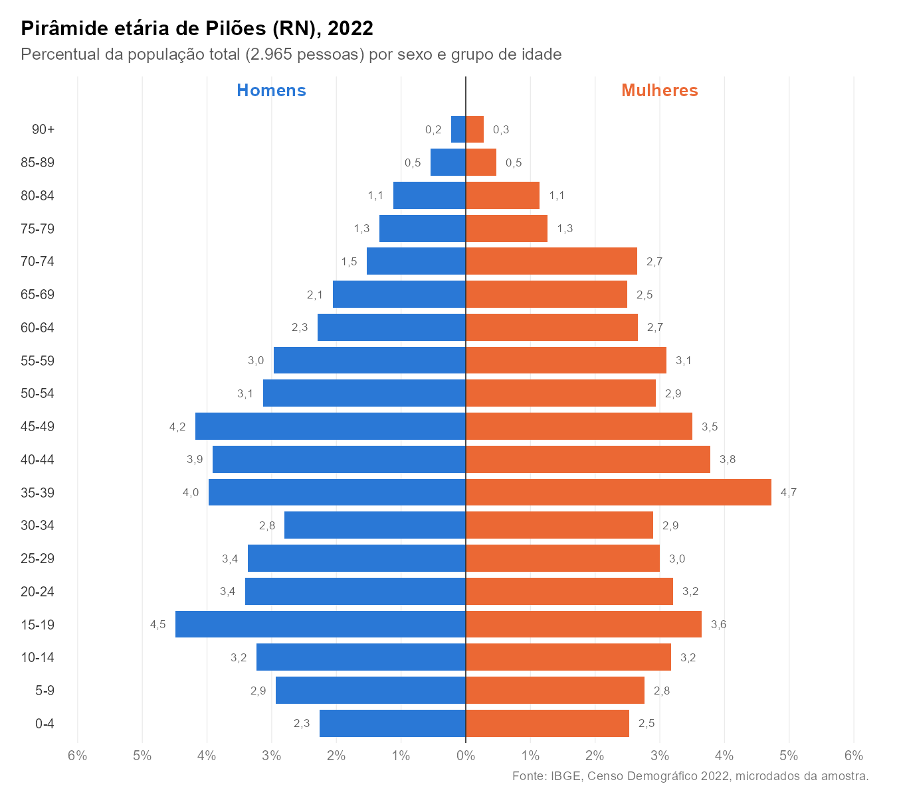

# Pilões (RN)

Resultados do Censo Demográfico 2022 (microdados da amostra). Gerado por `R/05_readmes.R`; veja a [página dos municípios](../README.md) e o [README principal](../../../../README.md).

População: **2.965** pessoas (1.015 registros na amostra).

## Estrutura etária

| Indicador | Pilões | RN |
|---|--:|--:|
| Razão de dependência jovem | 24,9 | 28,5 |
| Razão de dependência idosa | 22,2 | 15,1 |
| Razão de dependência total | 47,1 | 43,6 |
| Índice de envelhecimento | 89,4 | 52,9 |

Valores por 100 pessoas.

## Migração

Chegadas e saídas: mudanças de município nos últimos 10 anos.

| Indicador | Valor |
|---|--:|
| Nascidos no próprio município | 55,5% |
| Nascidos em outro município do Rio Grande do Norte | 35,7% |
| Nascidos em outra UF | 8,8% |
| Nascidos no exterior | 0,0% |
| Chegaram de outro município do Rio Grande do Norte | 246 |
| Chegaram de outra UF | 110 |
| Saíram para outro município da UF | 330 |
| Saíram para outra UF | 112 |
| Saldo migratório | -87 |
| Saldo por 1.000 habitantes | -29,3 |
| Chegaram do exterior | 0 |

Principais origens de quem chegou e destinos de quem saiu:

| Origem | Chegaram | Destino | Saíram |
|---|--:|---|--:|
| Alexandria (RN) | 77 | Alexandria (RN) | 51 |
| Mossoró (RN) | 35 | Parnamirim (RN) | 45 |
| Tenente Ananias (RN) | 30 | Palmas (TO) | 40 |
| Natal (RN) | 30 | Antônio Martins (RN) | 29 |
| Cotia (SP) | 23 | Tibau (RN) | 24 |

## Mortalidade

Óbitos de agosto de 2021 a julho de 2022 informados no Censo.

| Indicador | Pilões | RN |
|---|--:|--:|
| Óbitos no período | 10 | 22.488 |
| Registros de óbito na amostra | 4 |  |
| Taxa bruta de mortalidade (por mil) | 3,4 | 6,8 |
| Taxa padronizada por idade (por mil) | 3,2 | 6,8 |

Com poucos óbitos na amostra, as taxas deste município variam muito por acaso; por isso não há tábua de vida. Sem correção do sub-registro de óbitos do Censo.
