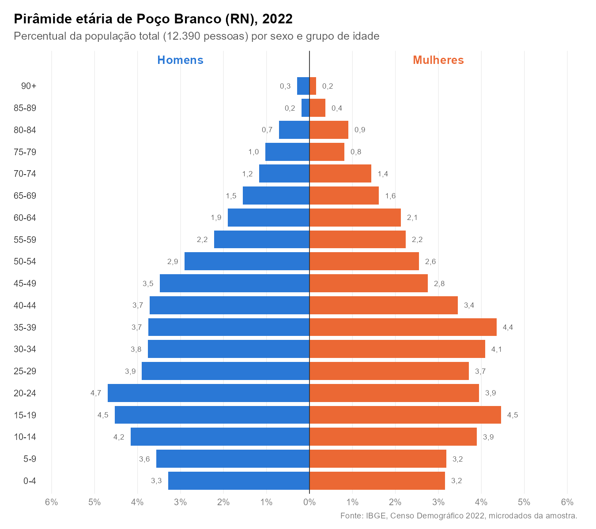

# Poço Branco (RN)

Resultados do Censo Demográfico 2022 (microdados da amostra). Gerado por `R/05_readmes.R`; veja a [página dos municípios](../README.md) e o [README principal](../../../../README.md).

População: **12.390** pessoas (2.595 registros na amostra).

## Estrutura etária

| Indicador | Poço Branco | RN |
|---|--:|--:|
| Razão de dependência jovem | 31,0 | 28,5 |
| Razão de dependência idosa | 14,9 | 15,1 |
| Razão de dependência total | 45,9 | 43,6 |
| Índice de envelhecimento | 48,1 | 52,9 |

Valores por 100 pessoas.

## Migração

Chegadas e saídas: mudanças de município nos últimos 10 anos.

| Indicador | Valor |
|---|--:|
| Nascidos no próprio município | 74,7% |
| Nascidos em outro município do Rio Grande do Norte | 22,6% |
| Nascidos em outra UF | 2,7% |
| Nascidos no exterior | 0,0% |
| Chegaram de outro município do Rio Grande do Norte | 758 |
| Chegaram de outra UF | 156 |
| Saíram para outro município da UF | 1.423 |
| Saíram para outra UF | 349 |
| Saldo migratório | -857 |
| Saldo por 1.000 habitantes | -69,2 |
| Chegaram do exterior | 6 |

Principais origens de quem chegou e destinos de quem saiu:

| Origem | Chegaram | Destino | Saíram |
|---|--:|---|--:|
| Natal (RN) | 269 | Natal (RN) | 553 |
| João Câmara (RN) | 142 | Parnamirim (RN) | 151 |
| Taipu (RN) | 133 | São Gonçalo do Amarante (RN) | 150 |
| Macapá (AP) | 62 | Ceará-Mirim (RN) | 136 |
| Bento Fernandes (RN) | 38 | João Câmara (RN) | 128 |

## Mortalidade

Óbitos de agosto de 2021 a julho de 2022 informados no Censo.

| Indicador | Poço Branco | RN |
|---|--:|--:|
| Óbitos no período | 65 | 22.488 |
| Registros de óbito na amostra | 14 |  |
| Taxa bruta de mortalidade (por mil) | 5,2 | 6,8 |
| Taxa padronizada por idade (por mil) | 5,4 | 6,8 |

Com poucos óbitos na amostra, as taxas deste município variam muito por acaso; por isso não há tábua de vida. Sem correção do sub-registro de óbitos do Censo.
