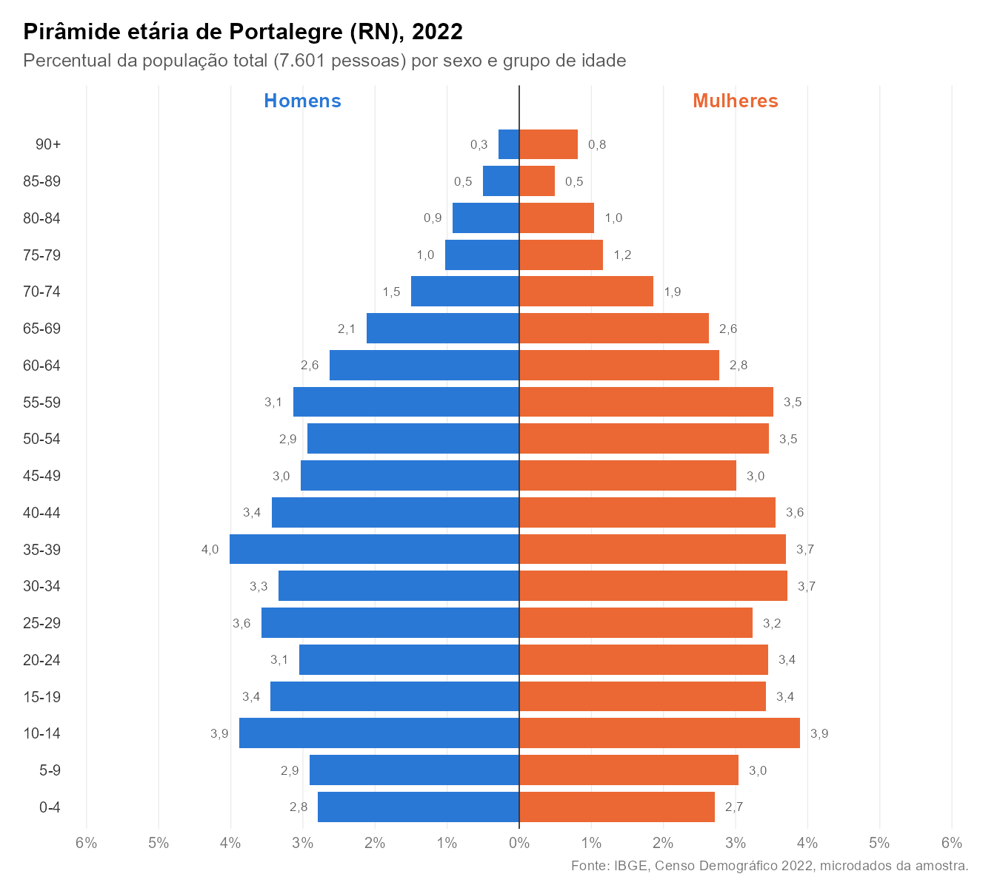

# Portalegre (RN)

Resultados do Censo Demográfico 2022 (microdados da amostra). Gerado por `R/05_readmes.R`; veja a [página dos municípios](../README.md) e o [README principal](../../../../README.md).

População: **7.601** pessoas (2.598 registros na amostra).

## Estrutura etária

| Indicador | Portalegre | RN |
|---|--:|--:|
| Razão de dependência jovem | 28,9 | 28,5 |
| Razão de dependência idosa | 21,6 | 15,1 |
| Razão de dependência total | 50,5 | 43,6 |
| Índice de envelhecimento | 74,6 | 52,9 |

Valores por 100 pessoas.

## Migração

Chegadas e saídas: mudanças de município nos últimos 10 anos.

| Indicador | Valor |
|---|--:|
| Nascidos no próprio município | 79,6% |
| Nascidos em outro município do Rio Grande do Norte | 14,7% |
| Nascidos em outra UF | 5,6% |
| Nascidos no exterior | 0,1% |
| Chegaram de outro município do Rio Grande do Norte | 738 |
| Chegaram de outra UF | 519 |
| Saíram para outro município da UF | 568 |
| Saíram para outra UF | 498 |
| Saldo migratório | +191 |
| Saldo por 1.000 habitantes | +25,2 |
| Chegaram do exterior | 0 |

Principais origens de quem chegou e destinos de quem saiu:

| Origem | Chegaram | Destino | Saíram |
|---|--:|---|--:|
| São Paulo (SP) | 178 | Brasília (DF) | 118 |
| Riacho da Cruz (RN) | 130 | Pau dos Ferros (RN) | 102 |
| Pau dos Ferros (RN) | 126 | Mossoró (RN) | 76 |
| Mossoró (RN) | 108 | Viçosa (RN) | 63 |
| Natal (RN) | 105 | Natal (RN) | 61 |

## Mortalidade

Óbitos de agosto de 2021 a julho de 2022 informados no Censo.

| Indicador | Portalegre | RN |
|---|--:|--:|
| Óbitos no período | 53 | 22.488 |
| Registros de óbito na amostra | 19 |  |
| Taxa bruta de mortalidade (por mil) | 6,9 | 6,8 |
| Taxa padronizada por idade (por mil) | 5,4 | 6,8 |

Com poucos óbitos na amostra, as taxas deste município variam muito por acaso; por isso não há tábua de vida. Sem correção do sub-registro de óbitos do Censo.
