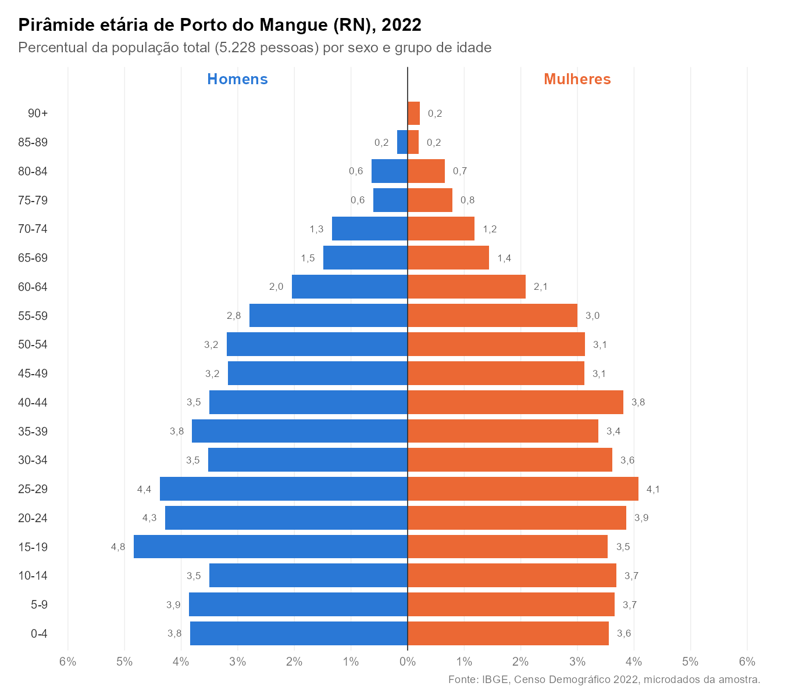

# Porto do Mangue (RN)

Resultados do Censo Demográfico 2022 (microdados da amostra). Gerado por `R/05_readmes.R`; veja a [página dos municípios](../README.md) e o [README principal](../../../../README.md).

População: **5.228** pessoas (1.684 registros na amostra).

## Estrutura etária

| Indicador | Porto do Mangue | RN |
|---|--:|--:|
| Razão de dependência jovem | 32,0 | 28,5 |
| Razão de dependência idosa | 12,6 | 15,1 |
| Razão de dependência total | 44,6 | 43,6 |
| Índice de envelhecimento | 39,5 | 52,9 |

Valores por 100 pessoas.

## Migração

Chegadas e saídas: mudanças de município nos últimos 10 anos.

| Indicador | Valor |
|---|--:|
| Nascidos no próprio município | 46,0% |
| Nascidos em outro município do Rio Grande do Norte | 51,0% |
| Nascidos em outra UF | 3,0% |
| Nascidos no exterior | 0,0% |
| Chegaram de outro município do Rio Grande do Norte | 736 |
| Chegaram de outra UF | 43 |
| Saíram para outro município da UF | 519 |
| Saíram para outra UF | 165 |
| Saldo migratório | +95 |
| Saldo por 1.000 habitantes | +18,2 |
| Chegaram do exterior | 0 |

Principais origens de quem chegou e destinos de quem saiu:

| Origem | Chegaram | Destino | Saíram |
|---|--:|---|--:|
| Mossoró (RN) | 262 | Serra do Mel (RN) | 153 |
| Serra do Mel (RN) | 137 | Areia Branca (RN) | 66 |
| Macau (RN) | 48 | Macau (RN) | 62 |
| Natal (RN) | 41 | Açu (RN) | 50 |
| Açu (RN) | 38 | Mossoró (RN) | 43 |

## Mortalidade

Óbitos de agosto de 2021 a julho de 2022 informados no Censo.

| Indicador | Porto do Mangue | RN |
|---|--:|--:|
| Óbitos no período | 24 | 22.488 |
| Registros de óbito na amostra | 8 |  |
| Taxa bruta de mortalidade (por mil) | 4,6 | 6,8 |
| Taxa padronizada por idade (por mil) | 5,6 | 6,8 |

Com poucos óbitos na amostra, as taxas deste município variam muito por acaso; por isso não há tábua de vida. Sem correção do sub-registro de óbitos do Censo.
