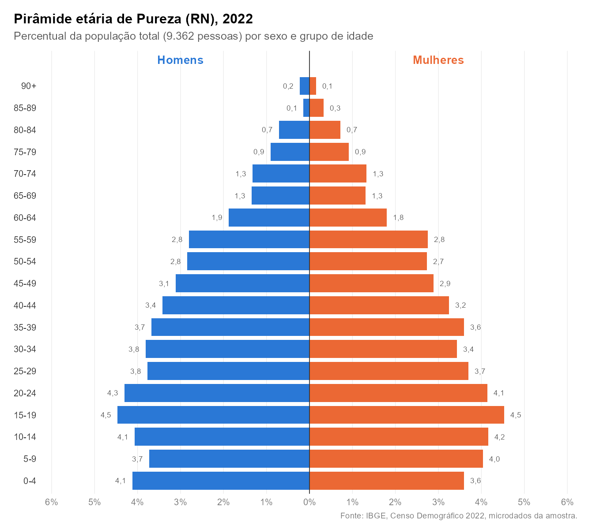

# Pureza (RN)

Resultados do Censo Demográfico 2022 (microdados da amostra). Gerado por `R/05_readmes.R`; veja a [página dos municípios](../README.md) e o [README principal](../../../../README.md).

População: **9.362** pessoas (1.901 registros na amostra).

## Estrutura etária

| Indicador | Pureza | RN |
|---|--:|--:|
| Razão de dependência jovem | 35,4 | 28,5 |
| Razão de dependência idosa | 14,0 | 15,1 |
| Razão de dependência total | 49,5 | 43,6 |
| Índice de envelhecimento | 39,6 | 52,9 |

Valores por 100 pessoas.

## Migração

Chegadas e saídas: mudanças de município nos últimos 10 anos.

| Indicador | Valor |
|---|--:|
| Nascidos no próprio município | 63,7% |
| Nascidos em outro município do Rio Grande do Norte | 33,3% |
| Nascidos em outra UF | 3,1% |
| Nascidos no exterior | 0,0% |
| Chegaram de outro município do Rio Grande do Norte | 1.628 |
| Chegaram de outra UF | 161 |
| Saíram para outro município da UF | 1.300 |
| Saíram para outra UF | 64 |
| Saldo migratório | +424 |
| Saldo por 1.000 habitantes | +45,3 |
| Chegaram do exterior | 0 |

Principais origens de quem chegou e destinos de quem saiu:

| Origem | Chegaram | Destino | Saíram |
|---|--:|---|--:|
| Natal (RN) | 583 | Natal (RN) | 406 |
| Ceará-Mirim (RN) | 194 | Touros (RN) | 316 |
| João Câmara (RN) | 164 | Ceará-Mirim (RN) | 168 |
| Touros (RN) | 160 | Parnamirim (RN) | 115 |
| Maxaranguape (RN) | 94 | João Câmara (RN) | 63 |

## Mortalidade

Óbitos de agosto de 2021 a julho de 2022 informados no Censo.

| Indicador | Pureza | RN |
|---|--:|--:|
| Óbitos no período | 48 | 22.488 |
| Registros de óbito na amostra | 10 |  |
| Taxa bruta de mortalidade (por mil) | 5,1 | 6,8 |
| Taxa padronizada por idade (por mil) | 5,6 | 6,8 |

Com poucos óbitos na amostra, as taxas deste município variam muito por acaso; por isso não há tábua de vida. Sem correção do sub-registro de óbitos do Censo.
