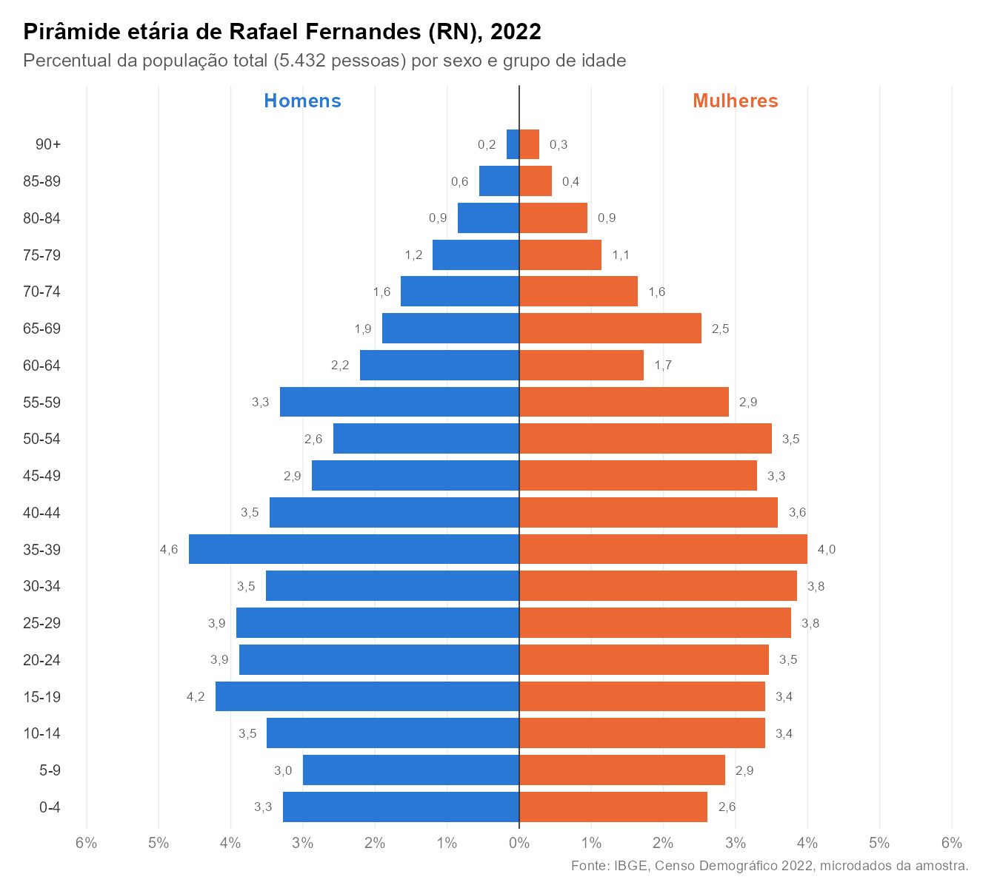

# Rafael Fernandes (RN)

Resultados do Censo Demográfico 2022 (microdados da amostra). Gerado por `R/05_readmes.R`; veja a [página dos municípios](../README.md) e o [README principal](../../../../README.md).

População: **5.432** pessoas (1.832 registros na amostra).

## Estrutura etária

| Indicador | Rafael Fernandes | RN |
|---|--:|--:|
| Razão de dependência jovem | 27,4 | 28,5 |
| Razão de dependência idosa | 19,5 | 15,1 |
| Razão de dependência total | 46,9 | 43,6 |
| Índice de envelhecimento | 71,3 | 52,9 |

Valores por 100 pessoas.

## Migração

Chegadas e saídas: mudanças de município nos últimos 10 anos.

| Indicador | Valor |
|---|--:|
| Nascidos no próprio município | 58,7% |
| Nascidos em outro município do Rio Grande do Norte | 29,8% |
| Nascidos em outra UF | 11,5% |
| Nascidos no exterior | 0,1% |
| Chegaram de outro município do Rio Grande do Norte | 732 |
| Chegaram de outra UF | 323 |
| Saíram para outro município da UF | 340 |
| Saíram para outra UF | 67 |
| Saldo migratório | +648 |
| Saldo por 1.000 habitantes | +119,3 |
| Chegaram do exterior | 0 |

Principais origens de quem chegou e destinos de quem saiu:

| Origem | Chegaram | Destino | Saíram |
|---|--:|---|--:|
| Pau dos Ferros (RN) | 282 | Pau dos Ferros (RN) | 158 |
| São Paulo (SP) | 119 | Água Nova (RN) | 45 |
| Marcelino Vieira (RN) | 86 | Brasília (DF) | 35 |
| Água Nova (RN) | 44 | Marcelino Vieira (RN) | 27 |
| Riacho de Santana (RN) | 37 | Catolé do Rocha (PB) | 19 |

## Mortalidade

Óbitos de agosto de 2021 a julho de 2022 informados no Censo.

| Indicador | Rafael Fernandes | RN |
|---|--:|--:|
| Óbitos no período | 21 | 22.488 |
| Registros de óbito na amostra | 7 |  |
| Taxa bruta de mortalidade (por mil) | 3,9 | 6,8 |
| Taxa padronizada por idade (por mil) | 3,5 | 6,8 |

Com poucos óbitos na amostra, as taxas deste município variam muito por acaso; por isso não há tábua de vida. Sem correção do sub-registro de óbitos do Censo.
