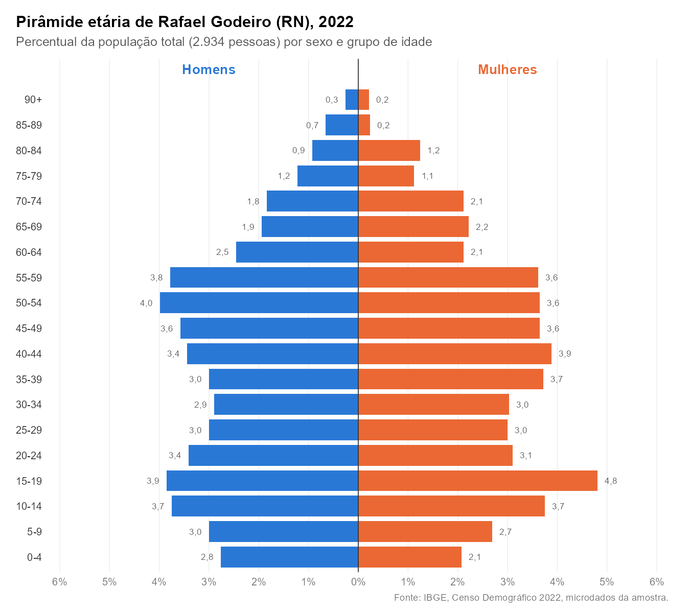

# Rafael Godeiro (RN)

Resultados do Censo Demográfico 2022 (microdados da amostra). Gerado por `R/05_readmes.R`; veja a [página dos municípios](../README.md) e o [README principal](../../../../README.md).

População: **2.934** pessoas (957 registros na amostra).

## Estrutura etária

| Indicador | Rafael Godeiro | RN |
|---|--:|--:|
| Razão de dependência jovem | 26,5 | 28,5 |
| Razão de dependência idosa | 20,6 | 15,1 |
| Razão de dependência total | 47,1 | 43,6 |
| Índice de envelhecimento | 77,7 | 52,9 |

Valores por 100 pessoas.

## Migração

Chegadas e saídas: mudanças de município nos últimos 10 anos.

| Indicador | Valor |
|---|--:|
| Nascidos no próprio município | 71,9% |
| Nascidos em outro município do Rio Grande do Norte | 21,8% |
| Nascidos em outra UF | 6,2% |
| Nascidos no exterior | 0,1% |
| Chegaram de outro município do Rio Grande do Norte | 456 |
| Chegaram de outra UF | 154 |
| Saíram para outro município da UF | 186 |
| Saíram para outra UF | 55 |
| Saldo migratório | +369 |
| Saldo por 1.000 habitantes | +125,8 |
| Chegaram do exterior | 0 |

Principais origens de quem chegou e destinos de quem saiu:

| Origem | Chegaram | Destino | Saíram |
|---|--:|---|--:|
| Mossoró (RN) | 76 | Natal (RN) | 42 |
| Patu (RN) | 76 | Parnamirim (RN) | 31 |
| Almino Afonso (RN) | 61 | Umarizal (RN) | 25 |
| Natal (RN) | 45 | Cajazeiras (PB) | 21 |
| São José dos Campos (SP) | 31 | Mossoró (RN) | 18 |

## Mortalidade

Óbitos de agosto de 2021 a julho de 2022 informados no Censo.

| Indicador | Rafael Godeiro | RN |
|---|--:|--:|
| Óbitos no período | 24 | 22.488 |
| Registros de óbito na amostra | 7 |  |
| Taxa bruta de mortalidade (por mil) | 8,1 | 6,8 |
| Taxa padronizada por idade (por mil) | 6,7 | 6,8 |

Com poucos óbitos na amostra, as taxas deste município variam muito por acaso; por isso não há tábua de vida. Sem correção do sub-registro de óbitos do Censo.
