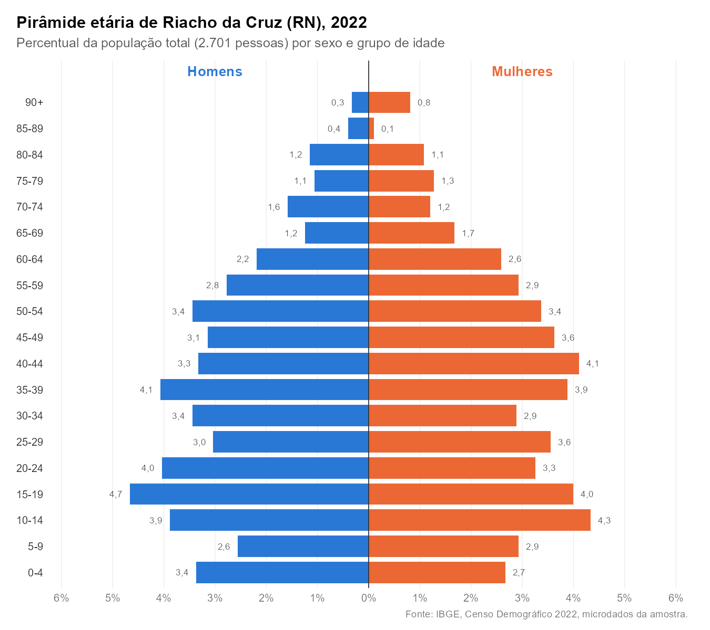

# Riacho da Cruz (RN)

Resultados do Censo Demográfico 2022 (microdados da amostra). Gerado por `R/05_readmes.R`; veja a [página dos municípios](../README.md) e o [README principal](../../../../README.md).

População: **2.701** pessoas (906 registros na amostra).

## Estrutura etária

| Indicador | Riacho da Cruz | RN |
|---|--:|--:|
| Razão de dependência jovem | 28,9 | 28,5 |
| Razão de dependência idosa | 17,4 | 15,1 |
| Razão de dependência total | 46,3 | 43,6 |
| Índice de envelhecimento | 60,4 | 52,9 |

Valores por 100 pessoas.

## Migração

Chegadas e saídas: mudanças de município nos últimos 10 anos.

| Indicador | Valor |
|---|--:|
| Nascidos no próprio município | 62,2% |
| Nascidos em outro município do Rio Grande do Norte | 35,2% |
| Nascidos em outra UF | 2,6% |
| Nascidos no exterior | 0,0% |
| Chegaram de outro município do Rio Grande do Norte | 182 |
| Chegaram de outra UF | 34 |
| Saíram para outro município da UF | 505 |
| Saíram para outra UF | 59 |
| Saldo migratório | -348 |
| Saldo por 1.000 habitantes | -128,7 |
| Chegaram do exterior | 0 |

Principais origens de quem chegou e destinos de quem saiu:

| Origem | Chegaram | Destino | Saíram |
|---|--:|---|--:|
| Mossoró (RN) | 37 | Portalegre (RN) | 130 |
| Natal (RN) | 33 | Mossoró (RN) | 89 |
| Portalegre (RN) | 17 | Apodi (RN) | 78 |
| Umarizal (RN) | 13 | Viçosa (RN) | 31 |
| Viçosa (RN) | 12 | Umarizal (RN) | 30 |

## Mortalidade

Óbitos de agosto de 2021 a julho de 2022 informados no Censo.

| Indicador | Riacho da Cruz | RN |
|---|--:|--:|
| Óbitos no período | 23 | 22.488 |
| Registros de óbito na amostra | 9 |  |
| Taxa bruta de mortalidade (por mil) | 8,7 | 6,8 |
| Taxa padronizada por idade (por mil) | 6,6 | 6,8 |

Com poucos óbitos na amostra, as taxas deste município variam muito por acaso; por isso não há tábua de vida. Sem correção do sub-registro de óbitos do Censo.
