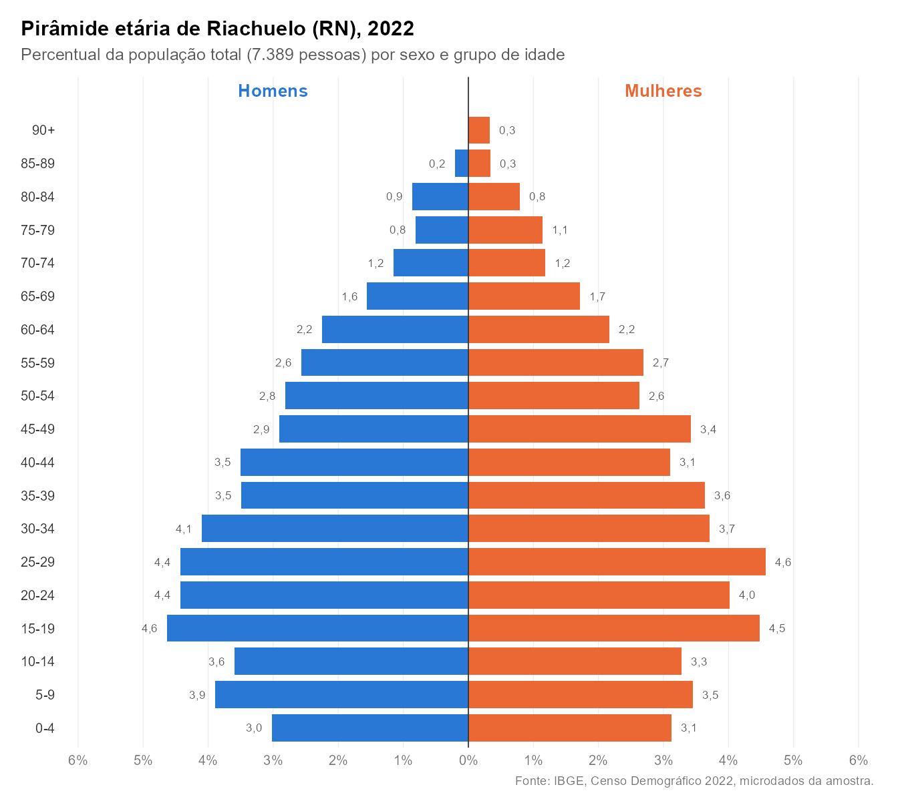

# Riachuelo (RN)

Resultados do Censo Demográfico 2022 (microdados da amostra). Gerado por `R/05_readmes.R`; veja a [página dos municípios](../README.md) e o [README principal](../../../../README.md).

População: **7.389** pessoas (1.567 registros na amostra).

## Estrutura etária

| Indicador | Riachuelo | RN |
|---|--:|--:|
| Razão de dependência jovem | 29,3 | 28,5 |
| Razão de dependência idosa | 14,5 | 15,1 |
| Razão de dependência total | 43,8 | 43,6 |
| Índice de envelhecimento | 49,5 | 52,9 |

Valores por 100 pessoas.

## Migração

Chegadas e saídas: mudanças de município nos últimos 10 anos.

| Indicador | Valor |
|---|--:|
| Nascidos no próprio município | 68,5% |
| Nascidos em outro município do Rio Grande do Norte | 28,5% |
| Nascidos em outra UF | 2,9% |
| Nascidos no exterior | 0,0% |
| Chegaram de outro município do Rio Grande do Norte | 896 |
| Chegaram de outra UF | 99 |
| Saíram para outro município da UF | 1.122 |
| Saíram para outra UF | 92 |
| Saldo migratório | -219 |
| Saldo por 1.000 habitantes | -29,6 |
| Chegaram do exterior | 0 |

Principais origens de quem chegou e destinos de quem saiu:

| Origem | Chegaram | Destino | Saíram |
|---|--:|---|--:|
| Natal (RN) | 268 | Natal (RN) | 279 |
| São Paulo do Potengi (RN) | 116 | Parnamirim (RN) | 261 |
| Parnamirim (RN) | 95 | São José de Mipibu (RN) | 72 |
| Bento Fernandes (RN) | 47 | Extremoz (RN) | 69 |
| Caiçara do Rio do Vento (RN) | 46 | São Gonçalo do Amarante (RN) | 61 |

## Mortalidade

Óbitos de agosto de 2021 a julho de 2022 informados no Censo.

| Indicador | Riachuelo | RN |
|---|--:|--:|
| Óbitos no período | 31 | 22.488 |
| Registros de óbito na amostra | 9 |  |
| Taxa bruta de mortalidade (por mil) | 4,1 | 6,8 |
| Taxa padronizada por idade (por mil) | 4,6 | 6,8 |

Com poucos óbitos na amostra, as taxas deste município variam muito por acaso; por isso não há tábua de vida. Sem correção do sub-registro de óbitos do Censo.
