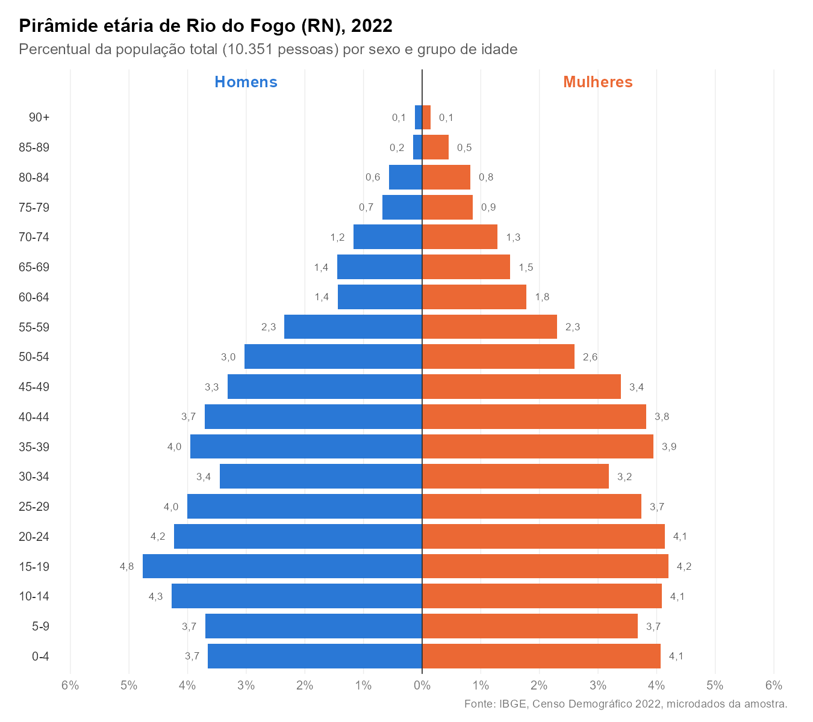

# Rio do Fogo (RN)

Resultados do Censo Demográfico 2022 (microdados da amostra). Gerado por `R/05_readmes.R`; veja a [página dos municípios](../README.md) e o [README principal](../../../../README.md).

População: **10.351** pessoas (2.032 registros na amostra).

## Estrutura etária

| Indicador | Rio do Fogo | RN |
|---|--:|--:|
| Razão de dependência jovem | 34,8 | 28,5 |
| Razão de dependência idosa | 13,7 | 15,1 |
| Razão de dependência total | 48,5 | 43,6 |
| Índice de envelhecimento | 39,2 | 52,9 |

Valores por 100 pessoas.

## Migração

Chegadas e saídas: mudanças de município nos últimos 10 anos.

| Indicador | Valor |
|---|--:|
| Nascidos no próprio município | 65,8% |
| Nascidos em outro município do Rio Grande do Norte | 31,8% |
| Nascidos em outra UF | 2,4% |
| Nascidos no exterior | 0,0% |
| Chegaram de outro município do Rio Grande do Norte | 1.224 |
| Chegaram de outra UF | 131 |
| Saíram para outro município da UF | 1.060 |
| Saíram para outra UF | 80 |
| Saldo migratório | +215 |
| Saldo por 1.000 habitantes | +20,7 |
| Chegaram do exterior | 0 |

Principais origens de quem chegou e destinos de quem saiu:

| Origem | Chegaram | Destino | Saíram |
|---|--:|---|--:|
| Natal (RN) | 523 | São Gonçalo do Amarante (RN) | 223 |
| Touros (RN) | 171 | Natal (RN) | 206 |
| Maxaranguape (RN) | 107 | Ceará-Mirim (RN) | 98 |
| Ceará-Mirim (RN) | 78 | Touros (RN) | 84 |
| João Câmara (RN) | 61 | Maxaranguape (RN) | 75 |

## Mortalidade

Óbitos de agosto de 2021 a julho de 2022 informados no Censo.

| Indicador | Rio do Fogo | RN |
|---|--:|--:|
| Óbitos no período | 76 | 22.488 |
| Registros de óbito na amostra | 14 |  |
| Taxa bruta de mortalidade (por mil) | 7,4 | 6,8 |
| Taxa padronizada por idade (por mil) | 8,5 | 6,8 |

Com poucos óbitos na amostra, as taxas deste município variam muito por acaso; por isso não há tábua de vida. Sem correção do sub-registro de óbitos do Censo.
