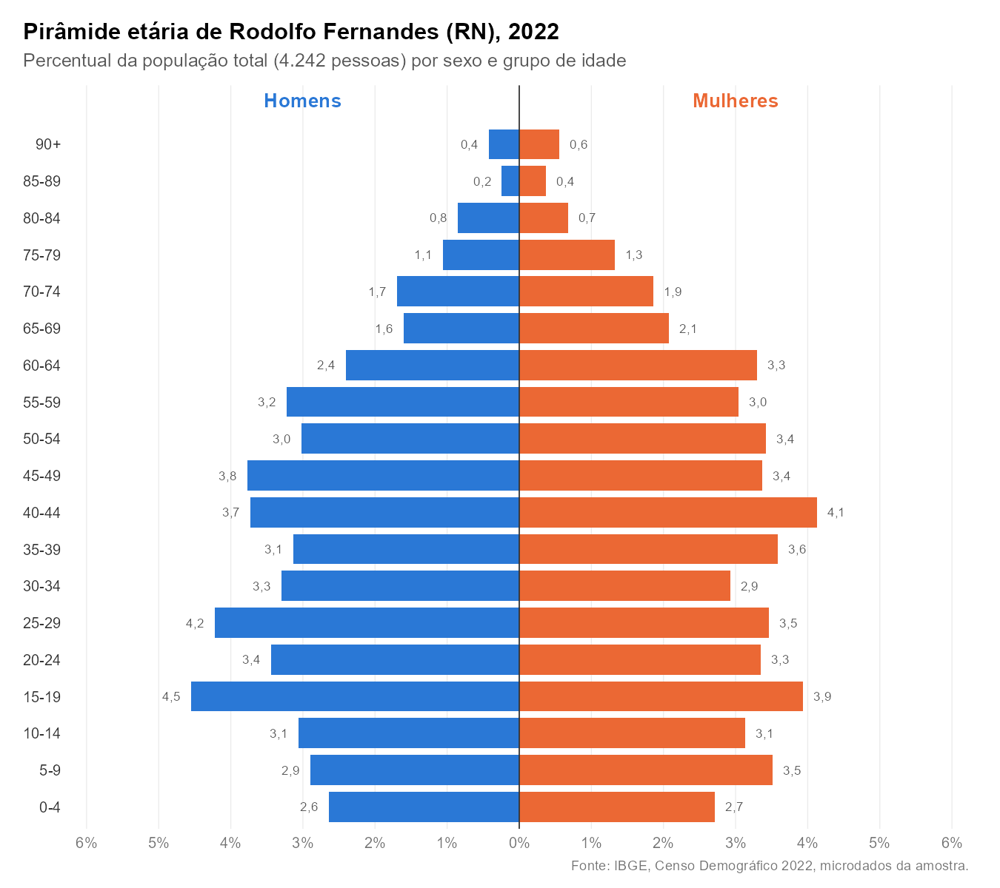

# Rodolfo Fernandes (RN)

Resultados do Censo Demográfico 2022 (microdados da amostra). Gerado por `R/05_readmes.R`; veja a [página dos municípios](../README.md) e o [README principal](../../../../README.md).

População: **4.242** pessoas (1.428 registros na amostra).

## Estrutura etária

| Indicador | Rodolfo Fernandes | RN |
|---|--:|--:|
| Razão de dependência jovem | 25,9 | 28,5 |
| Razão de dependência idosa | 18,4 | 15,1 |
| Razão de dependência total | 44,3 | 43,6 |
| Índice de envelhecimento | 70,9 | 52,9 |

Valores por 100 pessoas.

## Migração

Chegadas e saídas: mudanças de município nos últimos 10 anos.

| Indicador | Valor |
|---|--:|
| Nascidos no próprio município | 70,1% |
| Nascidos em outro município do Rio Grande do Norte | 15,4% |
| Nascidos em outra UF | 14,5% |
| Nascidos no exterior | 0,0% |
| Chegaram de outro município do Rio Grande do Norte | 140 |
| Chegaram de outra UF | 188 |
| Saíram para outro município da UF | 473 |
| Saíram para outra UF | 215 |
| Saldo migratório | -361 |
| Saldo por 1.000 habitantes | -85,0 |
| Chegaram do exterior | 0 |

Principais origens de quem chegou e destinos de quem saiu:

| Origem | Chegaram | Destino | Saíram |
|---|--:|---|--:|
| São Paulo (SP) | 45 | Mossoró (RN) | 154 |
| Fortaleza (CE) | 34 | Apodi (RN) | 85 |
| Mossoró (RN) | 28 | Potiretama (CE) | 71 |
| Potiretama (CE) | 28 | Pau dos Ferros (RN) | 64 |
| Natal (RN) | 24 | Aquiraz (CE) | 45 |

## Mortalidade

Óbitos de agosto de 2021 a julho de 2022 informados no Censo.

| Indicador | Rodolfo Fernandes | RN |
|---|--:|--:|
| Óbitos no período | 12 | 22.488 |
| Registros de óbito na amostra | 5 |  |
| Taxa bruta de mortalidade (por mil) | 2,9 | 6,8 |
| Taxa padronizada por idade (por mil) | 3,0 | 6,8 |

Com poucos óbitos na amostra, as taxas deste município variam muito por acaso; por isso não há tábua de vida. Sem correção do sub-registro de óbitos do Censo.
