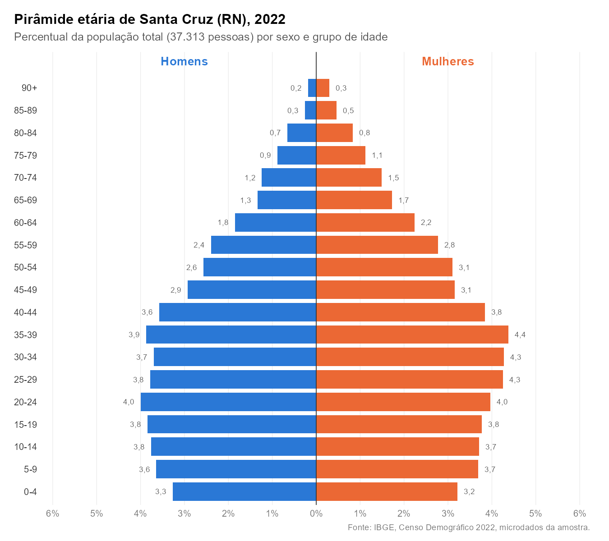

# Santa Cruz (RN)

Resultados do Censo Demográfico 2022 (microdados da amostra). Gerado por `R/05_readmes.R`; veja a [página dos municípios](../README.md) e o [README principal](../../../../README.md).

População: **37.313** pessoas (3.619 registros na amostra).

## Estrutura etária

| Indicador | Santa Cruz | RN |
|---|--:|--:|
| Razão de dependência jovem | 31,2 | 28,5 |
| Razão de dependência idosa | 15,4 | 15,1 |
| Razão de dependência total | 46,5 | 43,6 |
| Índice de envelhecimento | 49,2 | 52,9 |

Valores por 100 pessoas.

## Migração

Chegadas e saídas: mudanças de município nos últimos 10 anos.

| Indicador | Valor |
|---|--:|
| Nascidos no próprio município | 73,1% |
| Nascidos em outro município do Rio Grande do Norte | 21,0% |
| Nascidos em outra UF | 5,9% |
| Nascidos no exterior | 0,0% |
| Chegaram de outro município do Rio Grande do Norte | 3.589 |
| Chegaram de outra UF | 1.154 |
| Saíram para outro município da UF | 3.654 |
| Saíram para outra UF | 2.012 |
| Saldo migratório | -924 |
| Saldo por 1.000 habitantes | -24,8 |
| Chegaram do exterior | 7 |

Principais origens de quem chegou e destinos de quem saiu:

| Origem | Chegaram | Destino | Saíram |
|---|--:|---|--:|
| Natal (RN) | 1.111 | Parnamirim (RN) | 657 |
| São Bento do Trairí (RN) | 242 | Natal (RN) | 496 |
| Currais Novos (RN) | 223 | Uberlândia (MG) | 194 |
| Parnamirim (RN) | 213 | Macaíba (RN) | 168 |
| Sítio Novo (RN) | 168 | Currais Novos (RN) | 155 |

## Mortalidade

Óbitos de agosto de 2021 a julho de 2022 informados no Censo.

| Indicador | Santa Cruz | RN |
|---|--:|--:|
| Óbitos no período | 182 | 22.488 |
| Registros de óbito na amostra | 19 |  |
| Taxa bruta de mortalidade (por mil) | 4,9 | 6,8 |
| Taxa padronizada por idade (por mil) | 4,9 | 6,8 |

Com poucos óbitos na amostra, as taxas deste município variam muito por acaso; por isso não há tábua de vida. Sem correção do sub-registro de óbitos do Censo.
