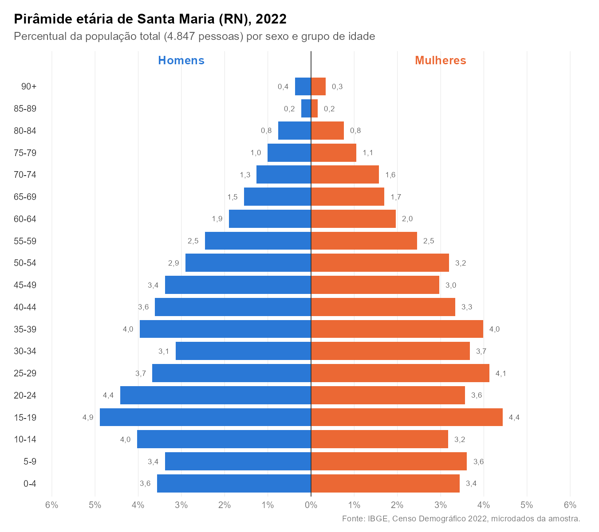

# Santa Maria (RN)

Resultados do Censo Demográfico 2022 (microdados da amostra). Gerado por `R/05_readmes.R`; veja a [página dos municípios](../README.md) e o [README principal](../../../../README.md).

População: **4.847** pessoas (1.639 registros na amostra).

## Estrutura etária

| Indicador | Santa Maria | RN |
|---|--:|--:|
| Razão de dependência jovem | 31,2 | 28,5 |
| Razão de dependência idosa | 15,8 | 15,1 |
| Razão de dependência total | 47,0 | 43,6 |
| Índice de envelhecimento | 50,7 | 52,9 |

Valores por 100 pessoas.

## Migração

Chegadas e saídas: mudanças de município nos últimos 10 anos.

| Indicador | Valor |
|---|--:|
| Nascidos no próprio município | 37,1% |
| Nascidos em outro município do Rio Grande do Norte | 58,9% |
| Nascidos em outra UF | 3,4% |
| Nascidos no exterior | 0,0% |
| Chegaram de outro município do Rio Grande do Norte | 574 |
| Chegaram de outra UF | 62 |
| Saíram para outro município da UF | 923 |
| Saíram para outra UF | 108 |
| Saldo migratório | -394 |
| Saldo por 1.000 habitantes | -81,3 |
| Chegaram do exterior | 0 |

Principais origens de quem chegou e destinos de quem saiu:

| Origem | Chegaram | Destino | Saíram |
|---|--:|---|--:|
| Natal (RN) | 111 | Ceará-Mirim (RN) | 130 |
| Ielmo Marinho (RN) | 63 | Macaíba (RN) | 124 |
| Parnamirim (RN) | 59 | Natal (RN) | 111 |
| São Paulo do Potengi (RN) | 48 | São Paulo do Potengi (RN) | 90 |
| Riachuelo (RN) | 42 | Ielmo Marinho (RN) | 80 |

## Mortalidade

Óbitos de agosto de 2021 a julho de 2022 informados no Censo.

| Indicador | Santa Maria | RN |
|---|--:|--:|
| Óbitos no período | 67 | 22.488 |
| Registros de óbito na amostra | 24 |  |
| Taxa bruta de mortalidade (por mil) | 13,9 | 6,8 |
| Taxa padronizada por idade (por mil) | 14,4 | 6,8 |

Com poucos óbitos na amostra, as taxas deste município variam muito por acaso; por isso não há tábua de vida. Sem correção do sub-registro de óbitos do Censo.
