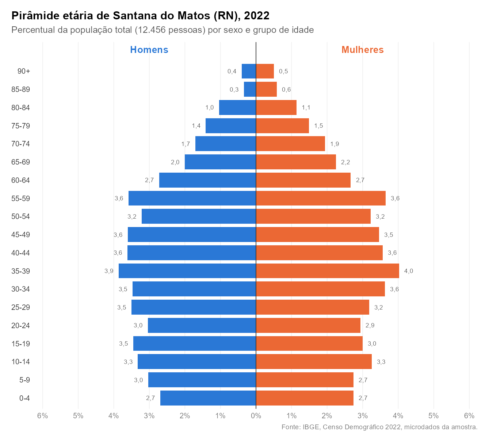

# Santana do Matos (RN)

Resultados do Censo Demográfico 2022 (microdados da amostra). Gerado por `R/05_readmes.R`; veja a [página dos municípios](../README.md) e o [README principal](../../../../README.md).

População: **12.456** pessoas (2.465 registros na amostra).

## Estrutura etária

| Indicador | Santana do Matos | RN |
|---|--:|--:|
| Razão de dependência jovem | 26,4 | 28,5 |
| Razão de dependência idosa | 22,0 | 15,1 |
| Razão de dependência total | 48,4 | 43,6 |
| Índice de envelhecimento | 83,3 | 52,9 |

Valores por 100 pessoas.

## Migração

Chegadas e saídas: mudanças de município nos últimos 10 anos.

| Indicador | Valor |
|---|--:|
| Nascidos no próprio município | 78,3% |
| Nascidos em outro município do Rio Grande do Norte | 18,9% |
| Nascidos em outra UF | 2,8% |
| Nascidos no exterior | 0,0% |
| Chegaram de outro município do Rio Grande do Norte | 1.243 |
| Chegaram de outra UF | 301 |
| Saíram para outro município da UF | 1.670 |
| Saíram para outra UF | 122 |
| Saldo migratório | -248 |
| Saldo por 1.000 habitantes | -19,9 |
| Chegaram do exterior | 0 |

Principais origens de quem chegou e destinos de quem saiu:

| Origem | Chegaram | Destino | Saíram |
|---|--:|---|--:|
| Natal (RN) | 420 | Natal (RN) | 235 |
| Mossoró (RN) | 99 | Angicos (RN) | 191 |
| Angicos (RN) | 86 | Parnamirim (RN) | 158 |
| Tenente Laurentino Cruz (RN) | 77 | Jucurutu (RN) | 99 |
| Resende (RJ) | 74 | Mossoró (RN) | 87 |

## Mortalidade

Óbitos de agosto de 2021 a julho de 2022 informados no Censo.

| Indicador | Santana do Matos | RN |
|---|--:|--:|
| Óbitos no período | 101 | 22.488 |
| Registros de óbito na amostra | 20 |  |
| Taxa bruta de mortalidade (por mil) | 8,1 | 6,8 |
| Taxa padronizada por idade (por mil) | 5,7 | 6,8 |

Com poucos óbitos na amostra, as taxas deste município variam muito por acaso; por isso não há tábua de vida. Sem correção do sub-registro de óbitos do Censo.
