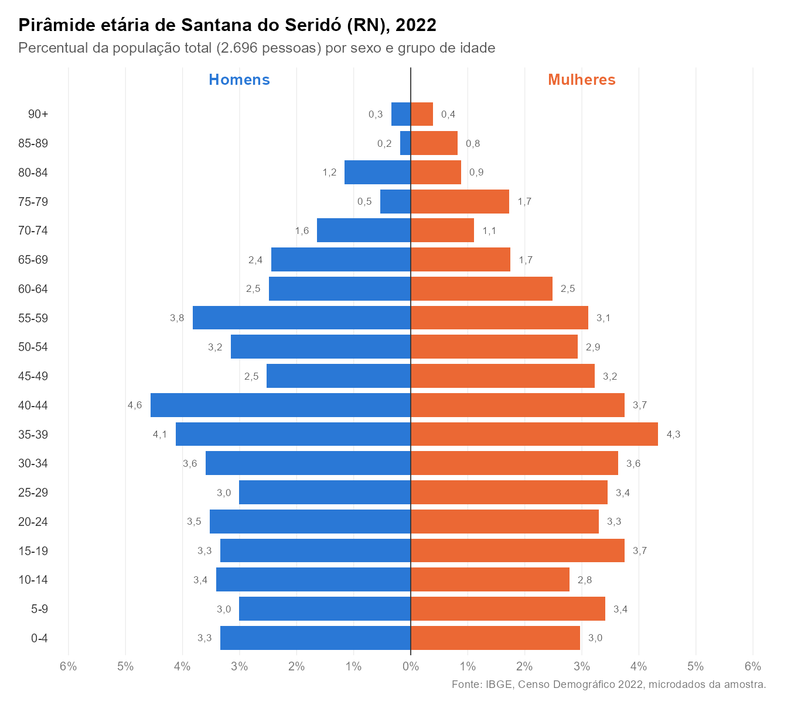

# Santana do Seridó (RN)

Resultados do Censo Demográfico 2022 (microdados da amostra). Gerado por `R/05_readmes.R`; veja a [página dos municípios](../README.md) e o [README principal](../../../../README.md).

População: **2.696** pessoas (864 registros na amostra).

## Estrutura etária

| Indicador | Santana do Seridó | RN |
|---|--:|--:|
| Razão de dependência jovem | 27,8 | 28,5 |
| Razão de dependência idosa | 19,1 | 15,1 |
| Razão de dependência total | 46,8 | 43,6 |
| Índice de envelhecimento | 68,6 | 52,9 |

Valores por 100 pessoas.

## Migração

Chegadas e saídas: mudanças de município nos últimos 10 anos.

| Indicador | Valor |
|---|--:|
| Nascidos no próprio município | 61,8% |
| Nascidos em outro município do Rio Grande do Norte | 22,6% |
| Nascidos em outra UF | 15,6% |
| Nascidos no exterior | 0,0% |
| Chegaram de outro município do Rio Grande do Norte | 324 |
| Chegaram de outra UF | 193 |
| Saíram para outro município da UF | 218 |
| Saíram para outra UF | 111 |
| Saldo migratório | +189 |
| Saldo por 1.000 habitantes | +70,1 |
| Chegaram do exterior | 0 |

Principais origens de quem chegou e destinos de quem saiu:

| Origem | Chegaram | Destino | Saíram |
|---|--:|---|--:|
| Parelhas (RN) | 136 | Parelhas (RN) | 116 |
| Natal (RN) | 73 | Rio de Janeiro (RJ) | 38 |
| São José do Sabugi (PB) | 57 | São José do Sabugi (PB) | 37 |
| Jardim do Seridó (RN) | 35 | Jardim do Seridó (RN) | 27 |
| Parnamirim (RN) | 30 | Carnaúba dos Dantas (RN) | 18 |

## Mortalidade

Óbitos de agosto de 2021 a julho de 2022 informados no Censo.

| Indicador | Santana do Seridó | RN |
|---|--:|--:|
| Óbitos no período | 13 | 22.488 |
| Registros de óbito na amostra | 5 |  |
| Taxa bruta de mortalidade (por mil) | 4,8 | 6,8 |
| Taxa padronizada por idade (por mil) | 4,0 | 6,8 |

Com poucos óbitos na amostra, as taxas deste município variam muito por acaso; por isso não há tábua de vida. Sem correção do sub-registro de óbitos do Censo.
