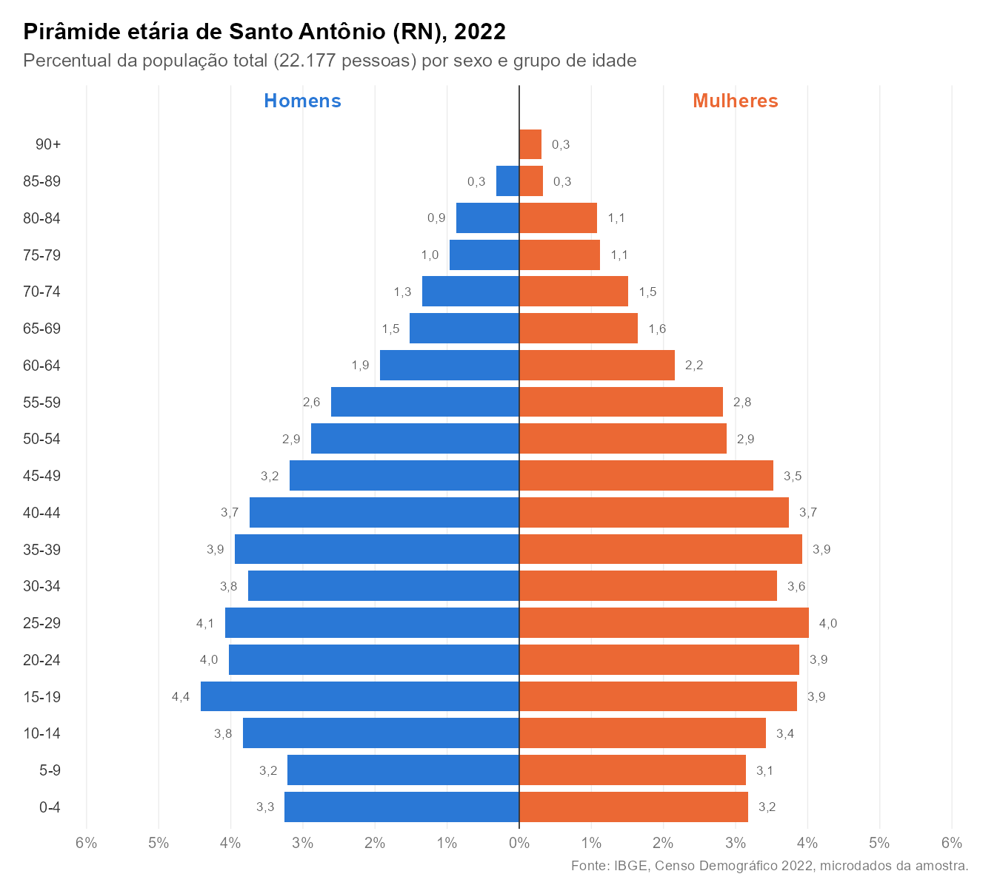

# Santo Antônio (RN)

Resultados do Censo Demográfico 2022 (microdados da amostra). Gerado por `R/05_readmes.R`; veja a [página dos municípios](../README.md) e o [README principal](../../../../README.md).

População: **22.177** pessoas (2.251 registros na amostra).

## Estrutura etária

| Indicador | Santo Antônio | RN |
|---|--:|--:|
| Razão de dependência jovem | 29,0 | 28,5 |
| Razão de dependência idosa | 16,0 | 15,1 |
| Razão de dependência total | 45,0 | 43,6 |
| Índice de envelhecimento | 55,0 | 52,9 |

Valores por 100 pessoas.

## Migração

Chegadas e saídas: mudanças de município nos últimos 10 anos.

| Indicador | Valor |
|---|--:|
| Nascidos no próprio município | 79,4% |
| Nascidos em outro município do Rio Grande do Norte | 15,3% |
| Nascidos em outra UF | 5,2% |
| Nascidos no exterior | 0,0% |
| Chegaram de outro município do Rio Grande do Norte | 1.620 |
| Chegaram de outra UF | 545 |
| Saíram para outro município da UF | 2.540 |
| Saíram para outra UF | 1.092 |
| Saldo migratório | -1.467 |
| Saldo por 1.000 habitantes | -66,1 |
| Chegaram do exterior | 28 |

Principais origens de quem chegou e destinos de quem saiu:

| Origem | Chegaram | Destino | Saíram |
|---|--:|---|--:|
| Natal (RN) | 513 | Parnamirim (RN) | 436 |
| Parnamirim (RN) | 180 | Natal (RN) | 370 |
| São Paulo (SP) | 153 | Rio de Janeiro (RJ) | 273 |
| Rio de Janeiro (RJ) | 152 | João Pessoa (PB) | 201 |
| Serrinha (RN) | 132 | Serrinha (RN) | 190 |

## Mortalidade

Óbitos de agosto de 2021 a julho de 2022 informados no Censo.

| Indicador | Santo Antônio | RN |
|---|--:|--:|
| Óbitos no período | 136 | 22.488 |
| Registros de óbito na amostra | 13 |  |
| Taxa bruta de mortalidade (por mil) | 6,1 | 6,8 |
| Taxa padronizada por idade (por mil) | 6,7 | 6,8 |

Com poucos óbitos na amostra, as taxas deste município variam muito por acaso; por isso não há tábua de vida. Sem correção do sub-registro de óbitos do Censo.
