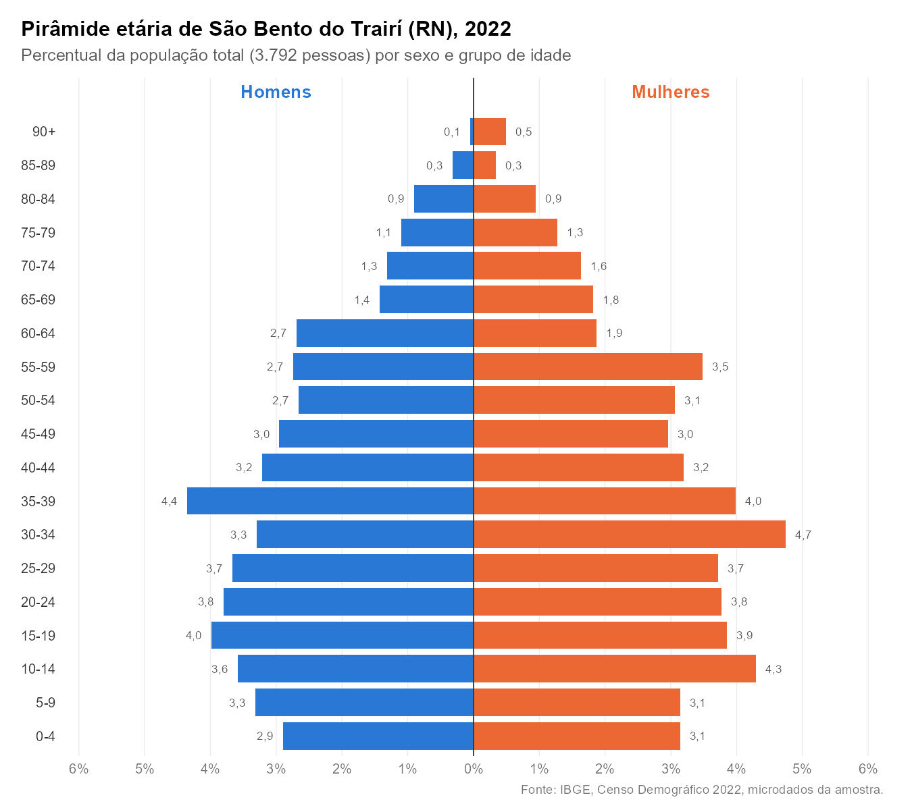

# São Bento do Trairí (RN)

Resultados do Censo Demográfico 2022 (microdados da amostra). Gerado por `R/05_readmes.R`; veja a [página dos municípios](../README.md) e o [README principal](../../../../README.md).

População: **3.792** pessoas (1.234 registros na amostra).

## Estrutura etária

| Indicador | São Bento do Trairí | RN |
|---|--:|--:|
| Razão de dependência jovem | 30,0 | 28,5 |
| Razão de dependência idosa | 17,1 | 15,1 |
| Razão de dependência total | 47,1 | 43,6 |
| Índice de envelhecimento | 57,1 | 52,9 |

Valores por 100 pessoas.

## Migração

Chegadas e saídas: mudanças de município nos últimos 10 anos.

| Indicador | Valor |
|---|--:|
| Nascidos no próprio município | 68,3% |
| Nascidos em outro município do Rio Grande do Norte | 25,6% |
| Nascidos em outra UF | 6,1% |
| Nascidos no exterior | 0,0% |
| Chegaram de outro município do Rio Grande do Norte | 404 |
| Chegaram de outra UF | 128 |
| Saíram para outro município da UF | 344 |
| Saíram para outra UF | 224 |
| Saldo migratório | -37 |
| Saldo por 1.000 habitantes | -9,7 |
| Chegaram do exterior | 0 |

Principais origens de quem chegou e destinos de quem saiu:

| Origem | Chegaram | Destino | Saíram |
|---|--:|---|--:|
| Santa Cruz (RN) | 150 | Santa Cruz (RN) | 242 |
| Natal (RN) | 115 | Cristalina (GO) | 70 |
| Japi (RN) | 28 | Campo Alegre de Goiás (GO) | 66 |
| Lagoa Nova (RN) | 23 | Cuité (PB) | 54 |
| Frei Martinho (PB) | 16 | Parnamirim (RN) | 24 |

## Mortalidade

Óbitos de agosto de 2021 a julho de 2022 informados no Censo.

| Indicador | São Bento do Trairí | RN |
|---|--:|--:|
| Óbitos no período | 20 | 22.488 |
| Registros de óbito na amostra | 6 |  |
| Taxa bruta de mortalidade (por mil) | 5,3 | 6,8 |
| Taxa padronizada por idade (por mil) | 4,7 | 6,8 |

Com poucos óbitos na amostra, as taxas deste município variam muito por acaso; por isso não há tábua de vida. Sem correção do sub-registro de óbitos do Censo.
