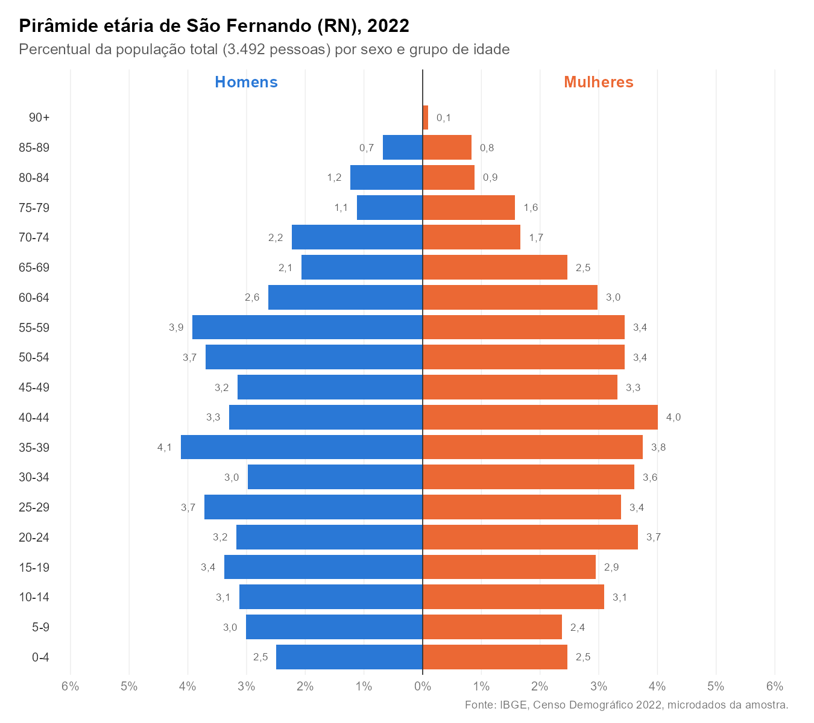

# São Fernando (RN)

Resultados do Censo Demográfico 2022 (microdados da amostra). Gerado por `R/05_readmes.R`; veja a [página dos municípios](../README.md) e o [README principal](../../../../README.md).

População: **3.492** pessoas (1.179 registros na amostra).

## Estrutura etária

| Indicador | São Fernando | RN |
|---|--:|--:|
| Razão de dependência jovem | 24,1 | 28,5 |
| Razão de dependência idosa | 21,6 | 15,1 |
| Razão de dependência total | 45,7 | 43,6 |
| Índice de envelhecimento | 89,6 | 52,9 |

Valores por 100 pessoas.

## Migração

Chegadas e saídas: mudanças de município nos últimos 10 anos.

| Indicador | Valor |
|---|--:|
| Nascidos no próprio município | 74,8% |
| Nascidos em outro município do Rio Grande do Norte | 19,9% |
| Nascidos em outra UF | 5,2% |
| Nascidos no exterior | 0,0% |
| Chegaram de outro município do Rio Grande do Norte | 355 |
| Chegaram de outra UF | 63 |
| Saíram para outro município da UF | 299 |
| Saíram para outra UF | 46 |
| Saldo migratório | +73 |
| Saldo por 1.000 habitantes | +20,9 |
| Chegaram do exterior | 0 |

Principais origens de quem chegou e destinos de quem saiu:

| Origem | Chegaram | Destino | Saíram |
|---|--:|---|--:|
| Caicó (RN) | 202 | Caicó (RN) | 192 |
| Jardim de Piranhas (RN) | 50 | São João do Sabugi (RN) | 22 |
| Natal (RN) | 16 | Jardim de Piranhas (RN) | 13 |
| Serra Negra do Norte (RN) | 16 | São Gonçalo do Amarante (CE) | 12 |
| Jucurutu (RN) | 14 | Timbaúba dos Batistas (RN) | 10 |

## Mortalidade

Óbitos de agosto de 2021 a julho de 2022 informados no Censo.

| Indicador | São Fernando | RN |
|---|--:|--:|
| Óbitos no período | 33 | 22.488 |
| Registros de óbito na amostra | 10 |  |
| Taxa bruta de mortalidade (por mil) | 9,4 | 6,8 |
| Taxa padronizada por idade (por mil) | 10,8 | 6,8 |

Com poucos óbitos na amostra, as taxas deste município variam muito por acaso; por isso não há tábua de vida. Sem correção do sub-registro de óbitos do Censo.
