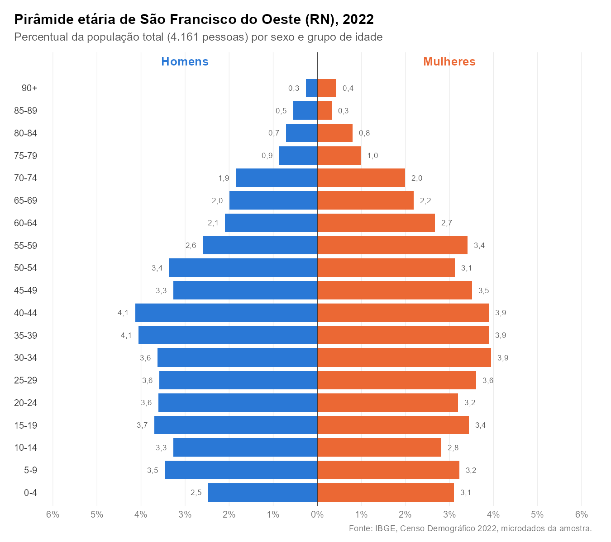

# São Francisco do Oeste (RN)

Resultados do Censo Demográfico 2022 (microdados da amostra). Gerado por `R/05_readmes.R`; veja a [página dos municípios](../README.md) e o [README principal](../../../../README.md).

População: **4.161** pessoas (1.325 registros na amostra).

## Estrutura etária

| Indicador | São Francisco do Oeste | RN |
|---|--:|--:|
| Razão de dependência jovem | 26,7 | 28,5 |
| Razão de dependência idosa | 18,9 | 15,1 |
| Razão de dependência total | 45,5 | 43,6 |
| Índice de envelhecimento | 70,6 | 52,9 |

Valores por 100 pessoas.

## Migração

Chegadas e saídas: mudanças de município nos últimos 10 anos.

| Indicador | Valor |
|---|--:|
| Nascidos no próprio município | 59,1% |
| Nascidos em outro município do Rio Grande do Norte | 27,2% |
| Nascidos em outra UF | 13,7% |
| Nascidos no exterior | 0,0% |
| Chegaram de outro município do Rio Grande do Norte | 404 |
| Chegaram de outra UF | 199 |
| Saíram para outro município da UF | 233 |
| Saíram para outra UF | 145 |
| Saldo migratório | +225 |
| Saldo por 1.000 habitantes | +54,2 |
| Chegaram do exterior | 0 |

Principais origens de quem chegou e destinos de quem saiu:

| Origem | Chegaram | Destino | Saíram |
|---|--:|---|--:|
| Pau dos Ferros (RN) | 131 | Francisco Dantas (RN) | 62 |
| Taboleiro Grande (RN) | 49 | Pau dos Ferros (RN) | 58 |
| Francisco Dantas (RN) | 39 | São Paulo (SP) | 39 |
| São Paulo (SP) | 37 | Brasília (DF) | 39 |
| Natal (RN) | 31 | Apodi (RN) | 35 |

## Mortalidade

Óbitos de agosto de 2021 a julho de 2022 informados no Censo.

| Indicador | São Francisco do Oeste | RN |
|---|--:|--:|
| Óbitos no período | 21 | 22.488 |
| Registros de óbito na amostra | 7 |  |
| Taxa bruta de mortalidade (por mil) | 5,0 | 6,8 |
| Taxa padronizada por idade (por mil) | 4,3 | 6,8 |

Com poucos óbitos na amostra, as taxas deste município variam muito por acaso; por isso não há tábua de vida. Sem correção do sub-registro de óbitos do Censo.
