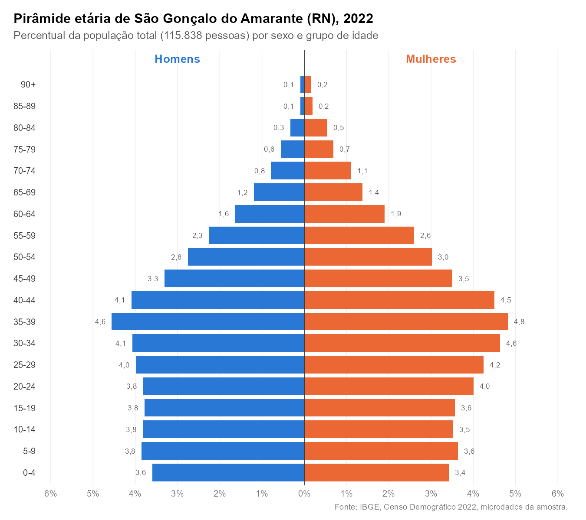
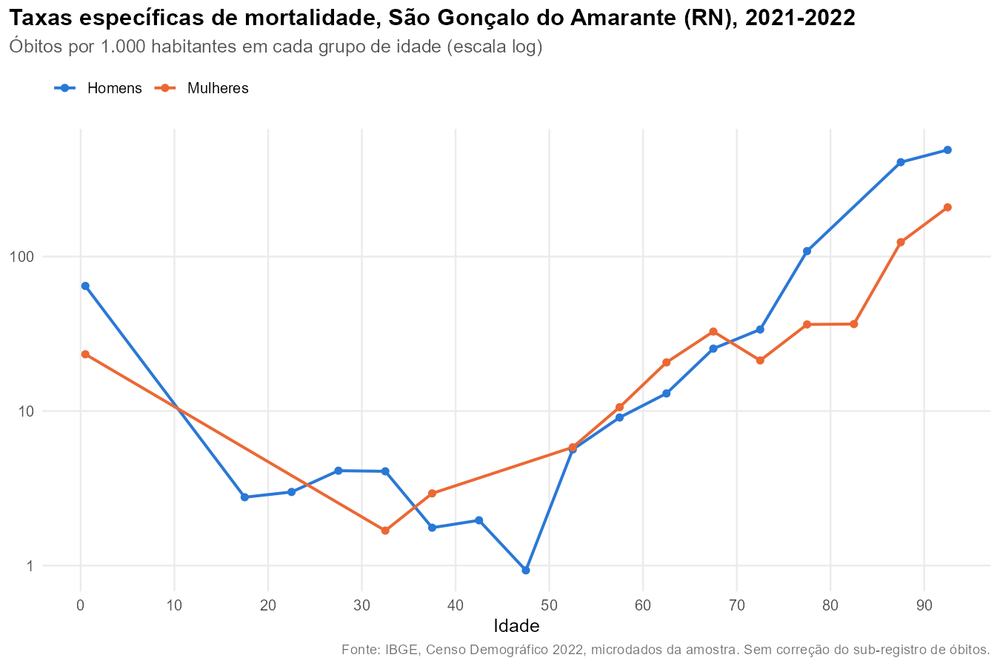

# São Gonçalo do Amarante (RN)

Resultados do Censo Demográfico 2022 (microdados da amostra). Gerado por `R/05_readmes.R`; veja a [página dos municípios](../README.md) e o [README principal](../../../../README.md).

População: **115.838** pessoas (13.273 registros na amostra).

## Estrutura etária

| Indicador | São Gonçalo do Amarante | RN |
|---|--:|--:|
| Razão de dependência jovem | 30,8 | 28,5 |
| Razão de dependência idosa | 10,0 | 15,1 |
| Razão de dependência total | 40,8 | 43,6 |
| Índice de envelhecimento | 32,6 | 52,9 |

Valores por 100 pessoas.

## Migração

Chegadas e saídas: mudanças de município nos últimos 10 anos.

| Indicador | Valor |
|---|--:|
| Nascidos no próprio município | 42,5% |
| Nascidos em outro município do Rio Grande do Norte | 50,0% |
| Nascidos em outra UF | 7,4% |
| Nascidos no exterior | 0,1% |
| Chegaram de outro município do Rio Grande do Norte | 31.420 |
| Chegaram de outra UF | 2.751 |
| Saíram para outro município da UF | 7.198 |
| Saíram para outra UF | 690 |
| Saldo migratório | +26.283 |
| Saldo por 1.000 habitantes | +226,9 |
| Chegaram do exterior | 78 |

Principais origens de quem chegou e destinos de quem saiu:

| Origem | Chegaram | Destino | Saíram |
|---|--:|---|--:|
| Natal (RN) | 23.352 | Natal (RN) | 2.105 |
| Macaíba (RN) | 884 | Extremoz (RN) | 1.470 |
| Parnamirim (RN) | 719 | Parnamirim (RN) | 734 |
| Extremoz (RN) | 669 | Macaíba (RN) | 605 |
| Ceará-Mirim (RN) | 549 | Ceará-Mirim (RN) | 558 |

## Mortalidade

Óbitos de agosto de 2021 a julho de 2022 informados no Censo.

| Indicador | São Gonçalo do Amarante | RN |
|---|--:|--:|
| Óbitos no período | 771 | 22.488 |
| Registros de óbito na amostra | 91 |  |
| Taxa bruta de mortalidade (por mil) | 6,7 | 6,8 |
| Taxa padronizada por idade (por mil) | 9,4 | 6,8 |
| Esperança de vida ao nascer, total | 72,1 | 77,2 |
| Esperança de vida ao nascer, homens | 68,5 | 74,5 |
| Esperança de vida ao nascer, mulheres | 76,6 | 79,7 |
| Esperança de vida aos 60 anos, total | 19,9 | 23,4 |

A tábua de vida usa poucos registros de óbito da amostra e deve ser lida como aproximada. Sem correção do sub-registro de óbitos do Censo.

