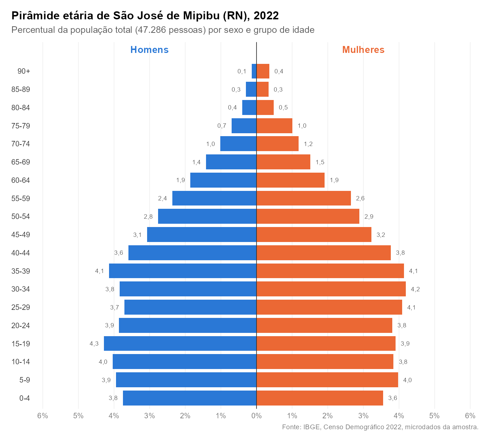

# São José de Mipibu (RN)

Resultados do Censo Demográfico 2022 (microdados da amostra). Gerado por `R/05_readmes.R`; veja a [página dos municípios](../README.md) e o [README principal](../../../../README.md).

População: **47.286** pessoas (4.508 registros na amostra).

## Estrutura etária

| Indicador | São José de Mipibu | RN |
|---|--:|--:|
| Razão de dependência jovem | 33,9 | 28,5 |
| Razão de dependência idosa | 13,0 | 15,1 |
| Razão de dependência total | 46,9 | 43,6 |
| Índice de envelhecimento | 38,3 | 52,9 |

Valores por 100 pessoas.

## Migração

Chegadas e saídas: mudanças de município nos últimos 10 anos.

| Indicador | Valor |
|---|--:|
| Nascidos no próprio município | 56,8% |
| Nascidos em outro município do Rio Grande do Norte | 34,5% |
| Nascidos em outra UF | 8,6% |
| Nascidos no exterior | 0,1% |
| Chegaram de outro município do Rio Grande do Norte | 8.854 |
| Chegaram de outra UF | 1.733 |
| Saíram para outro município da UF | 5.619 |
| Saíram para outra UF | 652 |
| Saldo migratório | +4.316 |
| Saldo por 1.000 habitantes | +91,3 |
| Chegaram do exterior | 24 |

Principais origens de quem chegou e destinos de quem saiu:

| Origem | Chegaram | Destino | Saíram |
|---|--:|---|--:|
| Natal (RN) | 3.069 | Parnamirim (RN) | 1.161 |
| Parnamirim (RN) | 2.744 | Natal (RN) | 940 |
| Nísia Floresta (RN) | 361 | Nísia Floresta (RN) | 824 |
| São Paulo (SP) | 353 | Monte Alegre (RN) | 384 |
| Vera Cruz (RN) | 266 | Macaíba (RN) | 276 |

## Mortalidade

Óbitos de agosto de 2021 a julho de 2022 informados no Censo.

| Indicador | São José de Mipibu | RN |
|---|--:|--:|
| Óbitos no período | 285 | 22.488 |
| Registros de óbito na amostra | 27 |  |
| Taxa bruta de mortalidade (por mil) | 6,0 | 6,8 |
| Taxa padronizada por idade (por mil) | 6,5 | 6,8 |

Com poucos óbitos na amostra, as taxas deste município variam muito por acaso; por isso não há tábua de vida. Sem correção do sub-registro de óbitos do Censo.
