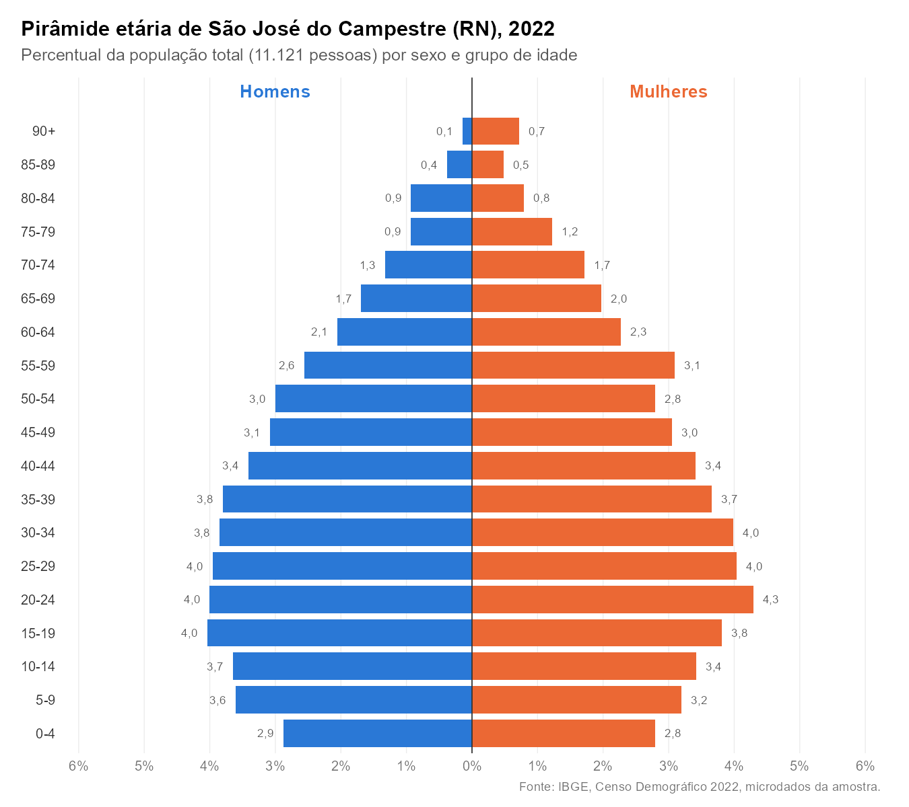

# São José do Campestre (RN)

Resultados do Censo Demográfico 2022 (microdados da amostra). Gerado por `R/05_readmes.R`; veja a [página dos municípios](../README.md) e o [README principal](../../../../README.md).

População: **11.121** pessoas (2.118 registros na amostra).

## Estrutura etária

| Indicador | São José do Campestre | RN |
|---|--:|--:|
| Razão de dependência jovem | 28,7 | 28,5 |
| Razão de dependência idosa | 18,0 | 15,1 |
| Razão de dependência total | 46,7 | 43,6 |
| Índice de envelhecimento | 63,0 | 52,9 |

Valores por 100 pessoas.

## Migração

Chegadas e saídas: mudanças de município nos últimos 10 anos.

| Indicador | Valor |
|---|--:|
| Nascidos no próprio município | 81,4% |
| Nascidos em outro município do Rio Grande do Norte | 15,0% |
| Nascidos em outra UF | 3,6% |
| Nascidos no exterior | 0,0% |
| Chegaram de outro município do Rio Grande do Norte | 930 |
| Chegaram de outra UF | 183 |
| Saíram para outro município da UF | 1.329 |
| Saíram para outra UF | 287 |
| Saldo migratório | -502 |
| Saldo por 1.000 habitantes | -45,2 |
| Chegaram do exterior | 0 |

Principais origens de quem chegou e destinos de quem saiu:

| Origem | Chegaram | Destino | Saíram |
|---|--:|---|--:|
| Natal (RN) | 328 | Parnamirim (RN) | 414 |
| Santo Antônio (RN) | 140 | Natal (RN) | 168 |
| Tangará (RN) | 69 | São José de Mipibu (RN) | 91 |
| Santa Cruz (RN) | 52 | Lagoa d'Anta (RN) | 71 |
| São Tomé (RN) | 35 | São Gonçalo do Amarante (RN) | 69 |

## Mortalidade

Óbitos de agosto de 2021 a julho de 2022 informados no Censo.

| Indicador | São José do Campestre | RN |
|---|--:|--:|
| Óbitos no período | 88 | 22.488 |
| Registros de óbito na amostra | 18 |  |
| Taxa bruta de mortalidade (por mil) | 7,9 | 6,8 |
| Taxa padronizada por idade (por mil) | 6,6 | 6,8 |

Com poucos óbitos na amostra, as taxas deste município variam muito por acaso; por isso não há tábua de vida. Sem correção do sub-registro de óbitos do Censo.
