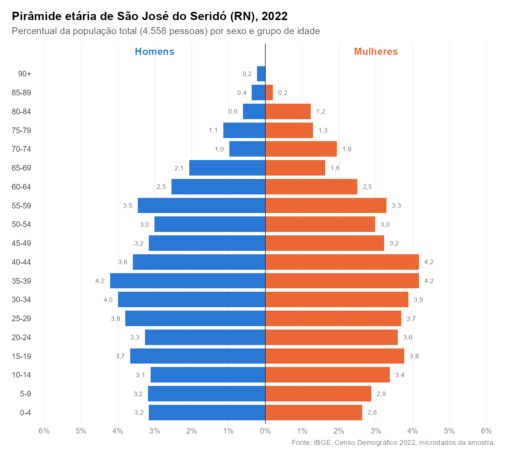

# São José do Seridó (RN)

Resultados do Censo Demográfico 2022 (microdados da amostra). Gerado por `R/05_readmes.R`; veja a [página dos municípios](../README.md) e o [README principal](../../../../README.md).

População: **4.558** pessoas (1.591 registros na amostra).

## Estrutura etária

| Indicador | São José do Seridó | RN |
|---|--:|--:|
| Razão de dependência jovem | 26,2 | 28,5 |
| Razão de dependência idosa | 16,7 | 15,1 |
| Razão de dependência total | 42,9 | 43,6 |
| Índice de envelhecimento | 63,6 | 52,9 |

Valores por 100 pessoas.

## Migração

Chegadas e saídas: mudanças de município nos últimos 10 anos.

| Indicador | Valor |
|---|--:|
| Nascidos no próprio município | 56,9% |
| Nascidos em outro município do Rio Grande do Norte | 36,4% |
| Nascidos em outra UF | 6,7% |
| Nascidos no exterior | 0,0% |
| Chegaram de outro município do Rio Grande do Norte | 686 |
| Chegaram de outra UF | 173 |
| Saíram para outro município da UF | 500 |
| Saíram para outra UF | 41 |
| Saldo migratório | +318 |
| Saldo por 1.000 habitantes | +69,7 |
| Chegaram do exterior | 0 |

Principais origens de quem chegou e destinos de quem saiu:

| Origem | Chegaram | Destino | Saíram |
|---|--:|---|--:|
| Caicó (RN) | 213 | Caicó (RN) | 198 |
| Jardim do Seridó (RN) | 119 | Cruzeta (RN) | 131 |
| Natal (RN) | 87 | São Gonçalo do Amarante (RN) | 49 |
| Cruzeta (RN) | 82 | Jardim do Seridó (RN) | 39 |
| São Paulo (SP) | 36 | Natal (RN) | 23 |

## Mortalidade

Óbitos de agosto de 2021 a julho de 2022 informados no Censo.

| Indicador | São José do Seridó | RN |
|---|--:|--:|
| Óbitos no período | 43 | 22.488 |
| Registros de óbito na amostra | 14 |  |
| Taxa bruta de mortalidade (por mil) | 9,5 | 6,8 |
| Taxa padronizada por idade (por mil) | 12,7 | 6,8 |

Com poucos óbitos na amostra, as taxas deste município variam muito por acaso; por isso não há tábua de vida. Sem correção do sub-registro de óbitos do Censo.
