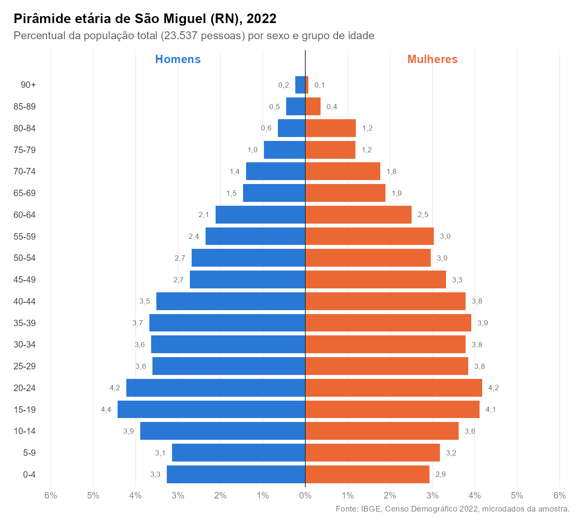

# São Miguel (RN)

Resultados do Censo Demográfico 2022 (microdados da amostra). Gerado por `R/05_readmes.R`; veja a [página dos municípios](../README.md) e o [README principal](../../../../README.md).

População: **23.537** pessoas (2.170 registros na amostra).

## Estrutura etária

| Indicador | São Miguel | RN |
|---|--:|--:|
| Razão de dependência jovem | 29,3 | 28,5 |
| Razão de dependência idosa | 17,0 | 15,1 |
| Razão de dependência total | 46,3 | 43,6 |
| Índice de envelhecimento | 58,1 | 52,9 |

Valores por 100 pessoas.

## Migração

Chegadas e saídas: mudanças de município nos últimos 10 anos.

| Indicador | Valor |
|---|--:|
| Nascidos no próprio município | 76,8% |
| Nascidos em outro município do Rio Grande do Norte | 6,9% |
| Nascidos em outra UF | 16,2% |
| Nascidos no exterior | 0,0% |
| Chegaram de outro município do Rio Grande do Norte | 885 |
| Chegaram de outra UF | 1.942 |
| Saíram para outro município da UF | 799 |
| Saíram para outra UF | 1.524 |
| Saldo migratório | +504 |
| Saldo por 1.000 habitantes | +21,4 |
| Chegaram do exterior | 8 |

Principais origens de quem chegou e destinos de quem saiu:

| Origem | Chegaram | Destino | Saíram |
|---|--:|---|--:|
| São Paulo (SP) | 399 | São Paulo (SP) | 260 |
| Natal (RN) | 225 | Pau dos Ferros (RN) | 233 |
| Icó (CE) | 180 | Icó (CE) | 207 |
| Pereiro (CE) | 173 | Pereiro (CE) | 179 |
| Pau dos Ferros (RN) | 137 | Coronel João Pessoa (RN) | 105 |

## Mortalidade

Óbitos de agosto de 2021 a julho de 2022 informados no Censo.

| Indicador | São Miguel | RN |
|---|--:|--:|
| Óbitos no período | 207 | 22.488 |
| Registros de óbito na amostra | 20 |  |
| Taxa bruta de mortalidade (por mil) | 8,8 | 6,8 |
| Taxa padronizada por idade (por mil) | 9,0 | 6,8 |

Com poucos óbitos na amostra, as taxas deste município variam muito por acaso; por isso não há tábua de vida. Sem correção do sub-registro de óbitos do Censo.
