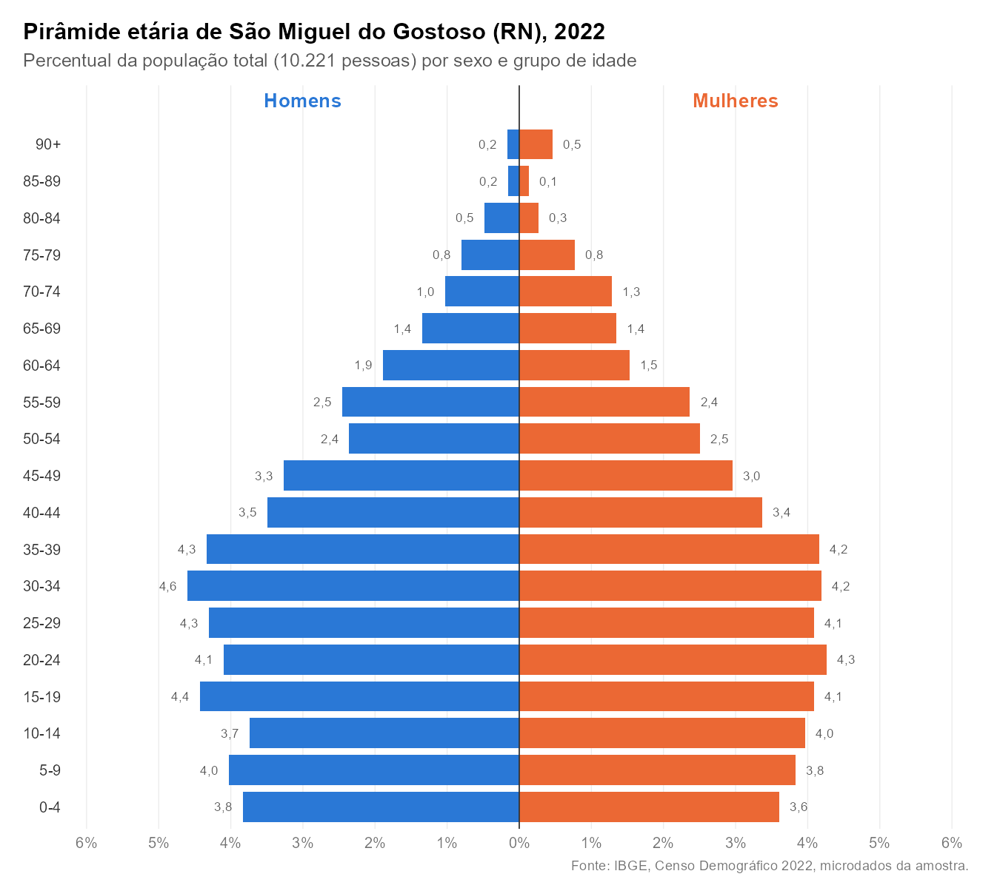

# São Miguel do Gostoso (RN)

Resultados do Censo Demográfico 2022 (microdados da amostra). Gerado por `R/05_readmes.R`; veja a [página dos municípios](../README.md) e o [README principal](../../../../README.md).

População: **10.221** pessoas (1.983 registros na amostra).

## Estrutura etária

| Indicador | São Miguel do Gostoso | RN |
|---|--:|--:|
| Razão de dependência jovem | 33,5 | 28,5 |
| Razão de dependência idosa | 12,0 | 15,1 |
| Razão de dependência total | 45,5 | 43,6 |
| Índice de envelhecimento | 35,8 | 52,9 |

Valores por 100 pessoas.

## Migração

Chegadas e saídas: mudanças de município nos últimos 10 anos.

| Indicador | Valor |
|---|--:|
| Nascidos no próprio município | 63,5% |
| Nascidos em outro município do Rio Grande do Norte | 31,0% |
| Nascidos em outra UF | 5,1% |
| Nascidos no exterior | 0,3% |
| Chegaram de outro município do Rio Grande do Norte | 1.382 |
| Chegaram de outra UF | 331 |
| Saíram para outro município da UF | 911 |
| Saíram para outra UF | 121 |
| Saldo migratório | +681 |
| Saldo por 1.000 habitantes | +66,6 |
| Chegaram do exterior | 15 |

Principais origens de quem chegou e destinos de quem saiu:

| Origem | Chegaram | Destino | Saíram |
|---|--:|---|--:|
| Natal (RN) | 454 | Natal (RN) | 278 |
| Touros (RN) | 387 | Touros (RN) | 172 |
| Caiçara do Norte (RN) | 57 | Parnamirim (RN) | 92 |
| Fernando Pedroza (RN) | 51 | Pureza (RN) | 60 |
| São Paulo (SP) | 39 | Macau (RN) | 40 |

## Mortalidade

Óbitos de agosto de 2021 a julho de 2022 informados no Censo.

| Indicador | São Miguel do Gostoso | RN |
|---|--:|--:|
| Óbitos no período | 87 | 22.488 |
| Registros de óbito na amostra | 17 |  |
| Taxa bruta de mortalidade (por mil) | 8,5 | 6,8 |
| Taxa padronizada por idade (por mil) | 11,1 | 6,8 |

Com poucos óbitos na amostra, as taxas deste município variam muito por acaso; por isso não há tábua de vida. Sem correção do sub-registro de óbitos do Censo.
