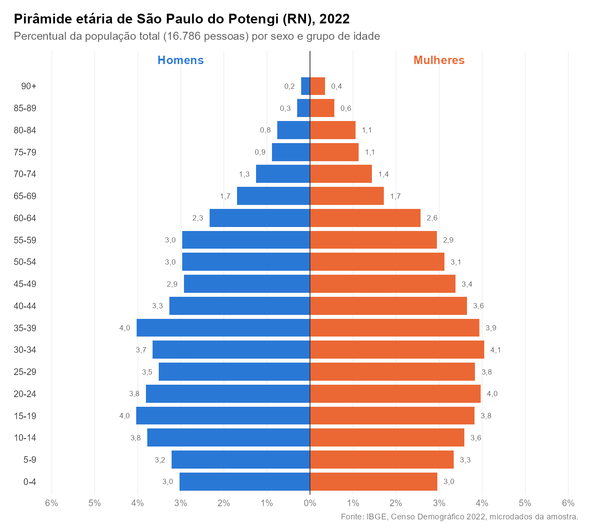

# São Paulo do Potengi (RN)

Resultados do Censo Demográfico 2022 (microdados da amostra). Gerado por `R/05_readmes.R`; veja a [página dos municípios](../README.md) e o [README principal](../../../../README.md).

População: **16.786** pessoas (3.314 registros na amostra).

## Estrutura etária

| Indicador | São Paulo do Potengi | RN |
|---|--:|--:|
| Razão de dependência jovem | 28,9 | 28,5 |
| Razão de dependência idosa | 16,5 | 15,1 |
| Razão de dependência total | 45,4 | 43,6 |
| Índice de envelhecimento | 57,0 | 52,9 |

Valores por 100 pessoas.

## Migração

Chegadas e saídas: mudanças de município nos últimos 10 anos.

| Indicador | Valor |
|---|--:|
| Nascidos no próprio município | 72,4% |
| Nascidos em outro município do Rio Grande do Norte | 22,9% |
| Nascidos em outra UF | 4,6% |
| Nascidos no exterior | 0,0% |
| Chegaram de outro município do Rio Grande do Norte | 1.670 |
| Chegaram de outra UF | 494 |
| Saíram para outro município da UF | 2.377 |
| Saíram para outra UF | 481 |
| Saldo migratório | -695 |
| Saldo por 1.000 habitantes | -41,4 |
| Chegaram do exterior | 0 |

Principais origens de quem chegou e destinos de quem saiu:

| Origem | Chegaram | Destino | Saíram |
|---|--:|---|--:|
| Natal (RN) | 525 | Natal (RN) | 730 |
| Parnamirim (RN) | 224 | Parnamirim (RN) | 461 |
| São Pedro (RN) | 123 | Macaíba (RN) | 127 |
| Santa Maria (RN) | 90 | Riachuelo (RN) | 116 |
| Macapá (AP) | 80 | Macapá (AP) | 82 |

## Mortalidade

Óbitos de agosto de 2021 a julho de 2022 informados no Censo.

| Indicador | São Paulo do Potengi | RN |
|---|--:|--:|
| Óbitos no período | 146 | 22.488 |
| Registros de óbito na amostra | 28 |  |
| Taxa bruta de mortalidade (por mil) | 8,7 | 6,8 |
| Taxa padronizada por idade (por mil) | 8,4 | 6,8 |

Com poucos óbitos na amostra, as taxas deste município variam muito por acaso; por isso não há tábua de vida. Sem correção do sub-registro de óbitos do Censo.
