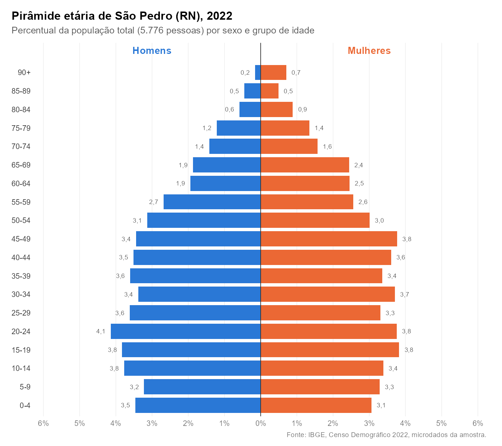

# São Pedro (RN)

Resultados do Censo Demográfico 2022 (microdados da amostra). Gerado por `R/05_readmes.R`; veja a [página dos municípios](../README.md) e o [README principal](../../../../README.md).

População: **5.776** pessoas (1.877 registros na amostra).

## Estrutura etária

| Indicador | São Pedro | RN |
|---|--:|--:|
| Razão de dependência jovem | 30,3 | 28,5 |
| Razão de dependência idosa | 19,7 | 15,1 |
| Razão de dependência total | 50,1 | 43,6 |
| Índice de envelhecimento | 65,1 | 52,9 |

Valores por 100 pessoas.

## Migração

Chegadas e saídas: mudanças de município nos últimos 10 anos.

| Indicador | Valor |
|---|--:|
| Nascidos no próprio município | 79,8% |
| Nascidos em outro município do Rio Grande do Norte | 17,9% |
| Nascidos em outra UF | 2,4% |
| Nascidos no exterior | 0,0% |
| Chegaram de outro município do Rio Grande do Norte | 521 |
| Chegaram de outra UF | 53 |
| Saíram para outro município da UF | 1.044 |
| Saíram para outra UF | 38 |
| Saldo migratório | -508 |
| Saldo por 1.000 habitantes | -88,0 |
| Chegaram do exterior | 0 |

Principais origens de quem chegou e destinos de quem saiu:

| Origem | Chegaram | Destino | Saíram |
|---|--:|---|--:|
| Natal (RN) | 157 | Natal (RN) | 157 |
| Macaíba (RN) | 88 | São Paulo do Potengi (RN) | 123 |
| Parnamirim (RN) | 55 | Macaíba (RN) | 120 |
| Santa Maria (RN) | 31 | Touros (RN) | 119 |
| São Gonçalo do Amarante (RN) | 25 | Bom Jesus (RN) | 105 |

## Mortalidade

Óbitos de agosto de 2021 a julho de 2022 informados no Censo.

| Indicador | São Pedro | RN |
|---|--:|--:|
| Óbitos no período | 30 | 22.488 |
| Registros de óbito na amostra | 10 |  |
| Taxa bruta de mortalidade (por mil) | 5,1 | 6,8 |
| Taxa padronizada por idade (por mil) | 4,7 | 6,8 |

Com poucos óbitos na amostra, as taxas deste município variam muito por acaso; por isso não há tábua de vida. Sem correção do sub-registro de óbitos do Censo.
