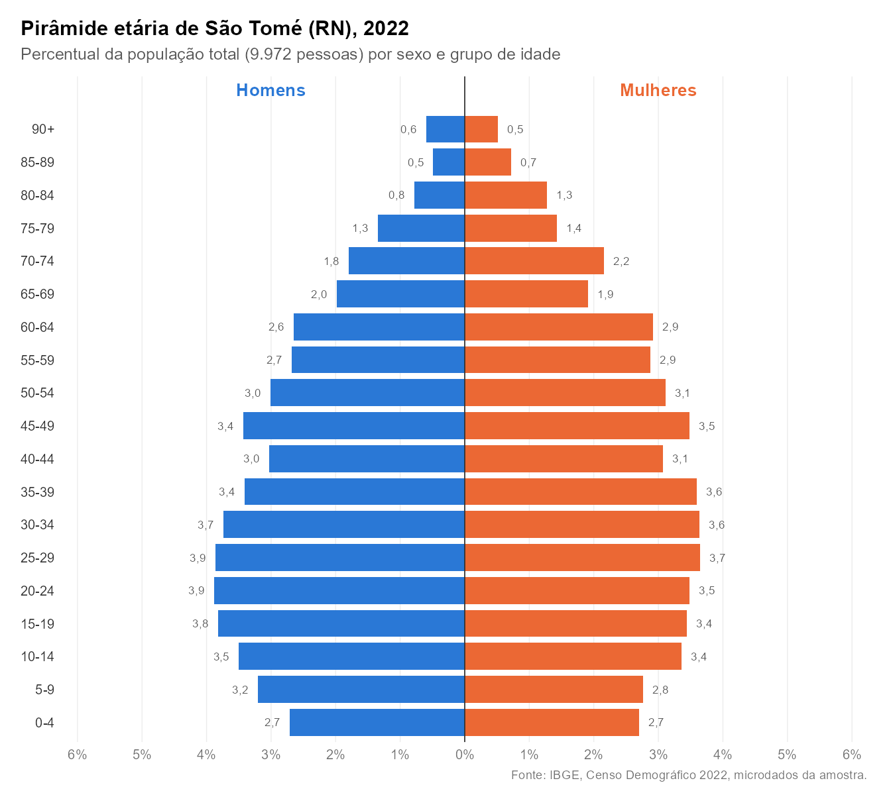

# São Tomé (RN)

Resultados do Censo Demográfico 2022 (microdados da amostra). Gerado por `R/05_readmes.R`; veja a [página dos municípios](../README.md) e o [README principal](../../../../README.md).

População: **9.972** pessoas (1.993 registros na amostra).

## Estrutura etária

| Indicador | São Tomé | RN |
|---|--:|--:|
| Razão de dependência jovem | 27,3 | 28,5 |
| Razão de dependência idosa | 22,5 | 15,1 |
| Razão de dependência total | 49,8 | 43,6 |
| Índice de envelhecimento | 82,2 | 52,9 |

Valores por 100 pessoas.

## Migração

Chegadas e saídas: mudanças de município nos últimos 10 anos.

| Indicador | Valor |
|---|--:|
| Nascidos no próprio município | 82,0% |
| Nascidos em outro município do Rio Grande do Norte | 15,9% |
| Nascidos em outra UF | 2,1% |
| Nascidos no exterior | 0,0% |
| Chegaram de outro município do Rio Grande do Norte | 802 |
| Chegaram de outra UF | 145 |
| Saíram para outro município da UF | 1.176 |
| Saíram para outra UF | 331 |
| Saldo migratório | -561 |
| Saldo por 1.000 habitantes | -56,2 |
| Chegaram do exterior | 0 |

Principais origens de quem chegou e destinos de quem saiu:

| Origem | Chegaram | Destino | Saíram |
|---|--:|---|--:|
| Natal (RN) | 338 | Natal (RN) | 386 |
| Parnamirim (RN) | 56 | Parnamirim (RN) | 226 |
| Santa Cruz (RN) | 44 | Cerro Corá (RN) | 71 |
| Barcelona (RN) | 39 | Nova Cruz (RN) | 55 |
| Lagoa Salgada (RN) | 38 | Macaíba (RN) | 49 |

## Mortalidade

Óbitos de agosto de 2021 a julho de 2022 informados no Censo.

| Indicador | São Tomé | RN |
|---|--:|--:|
| Óbitos no período | 64 | 22.488 |
| Registros de óbito na amostra | 14 |  |
| Taxa bruta de mortalidade (por mil) | 6,4 | 6,8 |
| Taxa padronizada por idade (por mil) | 5,0 | 6,8 |

Com poucos óbitos na amostra, as taxas deste município variam muito por acaso; por isso não há tábua de vida. Sem correção do sub-registro de óbitos do Censo.
