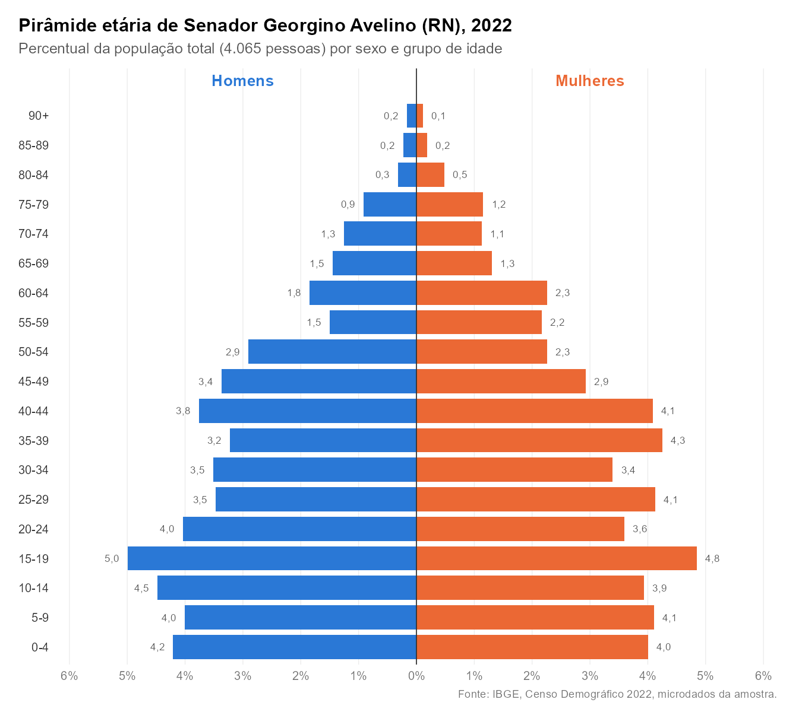

# Senador Georgino Avelino (RN)

Resultados do Censo Demográfico 2022 (microdados da amostra). Gerado por `R/05_readmes.R`; veja a [página dos municípios](../README.md) e o [README principal](../../../../README.md).

População: **4.065** pessoas (1.289 registros na amostra).

## Estrutura etária

| Indicador | Senador Georgino Avelino | RN |
|---|--:|--:|
| Razão de dependência jovem | 37,2 | 28,5 |
| Razão de dependência idosa | 13,1 | 15,1 |
| Razão de dependência total | 50,3 | 43,6 |
| Índice de envelhecimento | 35,2 | 52,9 |

Valores por 100 pessoas.

## Migração

Chegadas e saídas: mudanças de município nos últimos 10 anos.

| Indicador | Valor |
|---|--:|
| Nascidos no próprio município | 63,2% |
| Nascidos em outro município do Rio Grande do Norte | 33,2% |
| Nascidos em outra UF | 3,6% |
| Nascidos no exterior | 0,0% |
| Chegaram de outro município do Rio Grande do Norte | 561 |
| Chegaram de outra UF | 56 |
| Saíram para outro município da UF | 597 |
| Saíram para outra UF | 52 |
| Saldo migratório | -33 |
| Saldo por 1.000 habitantes | -8,1 |
| Chegaram do exterior | 0 |

Principais origens de quem chegou e destinos de quem saiu:

| Origem | Chegaram | Destino | Saíram |
|---|--:|---|--:|
| Natal (RN) | 132 | Natal (RN) | 131 |
| Nísia Floresta (RN) | 102 | Arês (RN) | 125 |
| Arês (RN) | 81 | Nísia Floresta (RN) | 96 |
| Parnamirim (RN) | 52 | Parnamirim (RN) | 89 |
| São José de Mipibu (RN) | 42 | Balneário Piçarras (SC) | 52 |

## Mortalidade

Óbitos de agosto de 2021 a julho de 2022 informados no Censo.

| Indicador | Senador Georgino Avelino | RN |
|---|--:|--:|
| Óbitos no período | 22 | 22.488 |
| Registros de óbito na amostra | 7 |  |
| Taxa bruta de mortalidade (por mil) | 5,4 | 6,8 |
| Taxa padronizada por idade (por mil) | 6,8 | 6,8 |

Com poucos óbitos na amostra, as taxas deste município variam muito por acaso; por isso não há tábua de vida. Sem correção do sub-registro de óbitos do Censo.
