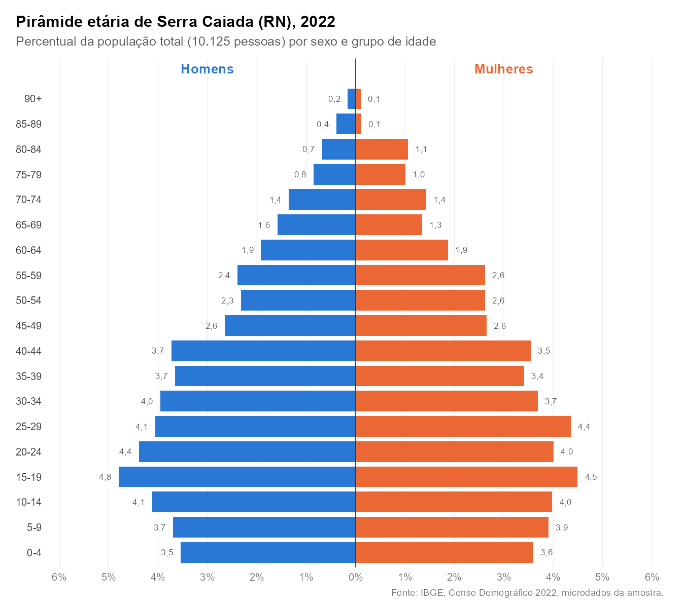

# Serra Caiada (RN)

Resultados do Censo Demográfico 2022 (microdados da amostra). Gerado por `R/05_readmes.R`; veja a [página dos municípios](../README.md) e o [README principal](../../../../README.md).

População: **10.125** pessoas (1.904 registros na amostra).

## Estrutura etária

| Indicador | Serra Caiada | RN |
|---|--:|--:|
| Razão de dependência jovem | 34,0 | 28,5 |
| Razão de dependência idosa | 15,0 | 15,1 |
| Razão de dependência total | 49,0 | 43,6 |
| Índice de envelhecimento | 44,1 | 52,9 |

Valores por 100 pessoas.

## Migração

Chegadas e saídas: mudanças de município nos últimos 10 anos.

| Indicador | Valor |
|---|--:|
| Nascidos no próprio município | 69,5% |
| Nascidos em outro município do Rio Grande do Norte | 25,7% |
| Nascidos em outra UF | 4,7% |
| Nascidos no exterior | 0,0% |
| Chegaram de outro município do Rio Grande do Norte | 1.216 |
| Chegaram de outra UF | 226 |
| Saíram para outro município da UF | 1.139 |
| Saíram para outra UF | 153 |
| Saldo migratório | +150 |
| Saldo por 1.000 habitantes | +14,8 |
| Chegaram do exterior | 0 |

Principais origens de quem chegou e destinos de quem saiu:

| Origem | Chegaram | Destino | Saíram |
|---|--:|---|--:|
| Natal (RN) | 357 | Parnamirim (RN) | 280 |
| Tangará (RN) | 139 | Natal (RN) | 199 |
| Senador Elói de Souza (RN) | 95 | Tangará (RN) | 99 |
| Parnamirim (RN) | 81 | Macaíba (RN) | 65 |
| São José de Mipibu (RN) | 72 | Januário Cicco (RN) | 64 |

## Mortalidade

Óbitos de agosto de 2021 a julho de 2022 informados no Censo.

| Indicador | Serra Caiada | RN |
|---|--:|--:|
| Óbitos no período | 57 | 22.488 |
| Registros de óbito na amostra | 12 |  |
| Taxa bruta de mortalidade (por mil) | 5,7 | 6,8 |
| Taxa padronizada por idade (por mil) | 7,0 | 6,8 |

Com poucos óbitos na amostra, as taxas deste município variam muito por acaso; por isso não há tábua de vida. Sem correção do sub-registro de óbitos do Censo.
