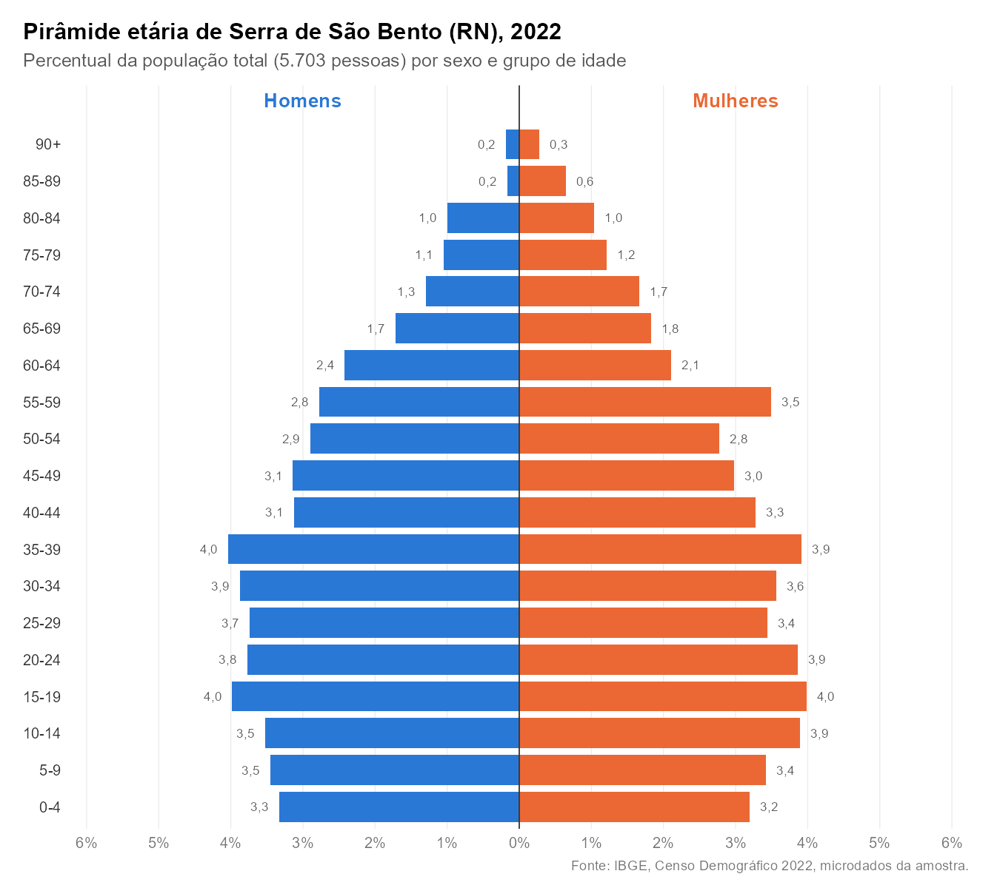

# Serra de São Bento (RN)

Resultados do Censo Demográfico 2022 (microdados da amostra). Gerado por `R/05_readmes.R`; veja a [página dos municípios](../README.md) e o [README principal](../../../../README.md).

População: **5.703** pessoas (1.875 registros na amostra).

## Estrutura etária

| Indicador | Serra de São Bento | RN |
|---|--:|--:|
| Razão de dependência jovem | 31,0 | 28,5 |
| Razão de dependência idosa | 18,0 | 15,1 |
| Razão de dependência total | 49,0 | 43,6 |
| Índice de envelhecimento | 58,0 | 52,9 |

Valores por 100 pessoas.

## Migração

Chegadas e saídas: mudanças de município nos últimos 10 anos.

| Indicador | Valor |
|---|--:|
| Nascidos no próprio município | 76,6% |
| Nascidos em outro município do Rio Grande do Norte | 16,1% |
| Nascidos em outra UF | 7,3% |
| Nascidos no exterior | 0,0% |
| Chegaram de outro município do Rio Grande do Norte | 307 |
| Chegaram de outra UF | 277 |
| Saíram para outro município da UF | 358 |
| Saíram para outra UF | 117 |
| Saldo migratório | +108 |
| Saldo por 1.000 habitantes | +18,9 |
| Chegaram do exterior | 0 |

Principais origens de quem chegou e destinos de quem saiu:

| Origem | Chegaram | Destino | Saíram |
|---|--:|---|--:|
| Natal (RN) | 142 | Natal (RN) | 85 |
| Rio de Janeiro (RJ) | 102 | Araruna (PB) | 75 |
| Parnamirim (RN) | 41 | Parnamirim (RN) | 64 |
| João Pessoa (PB) | 38 | Passa e Fica (RN) | 60 |
| Araruna (PB) | 28 | São Vicente (RN) | 28 |

## Mortalidade

Óbitos de agosto de 2021 a julho de 2022 informados no Censo.

| Indicador | Serra de São Bento | RN |
|---|--:|--:|
| Óbitos no período | 31 | 22.488 |
| Registros de óbito na amostra | 11 |  |
| Taxa bruta de mortalidade (por mil) | 5,4 | 6,8 |
| Taxa padronizada por idade (por mil) | 5,2 | 6,8 |

Com poucos óbitos na amostra, as taxas deste município variam muito por acaso; por isso não há tábua de vida. Sem correção do sub-registro de óbitos do Censo.
