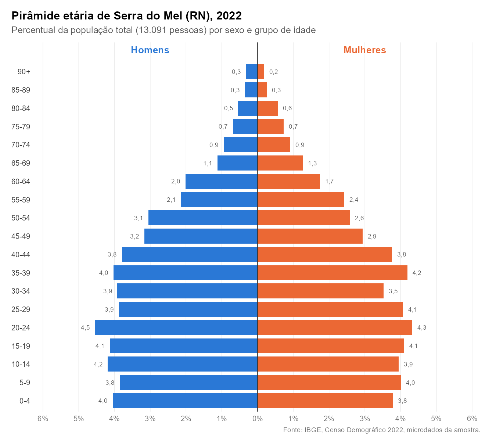

# Serra do Mel (RN)

Resultados do Censo Demográfico 2022 (microdados da amostra). Gerado por `R/05_readmes.R`; veja a [página dos municípios](../README.md) e o [README principal](../../../../README.md).

População: **13.091** pessoas (2.665 registros na amostra).

## Estrutura etária

| Indicador | Serra do Mel | RN |
|---|--:|--:|
| Razão de dependência jovem | 34,9 | 28,5 |
| Razão de dependência idosa | 11,5 | 15,1 |
| Razão de dependência total | 46,4 | 43,6 |
| Índice de envelhecimento | 33,1 | 52,9 |

Valores por 100 pessoas.

## Migração

Chegadas e saídas: mudanças de município nos últimos 10 anos.

| Indicador | Valor |
|---|--:|
| Nascidos no próprio município | 36,1% |
| Nascidos em outro município do Rio Grande do Norte | 56,1% |
| Nascidos em outra UF | 7,4% |
| Nascidos no exterior | 0,0% |
| Chegaram de outro município do Rio Grande do Norte | 2.151 |
| Chegaram de outra UF | 421 |
| Saíram para outro município da UF | 901 |
| Saíram para outra UF | 76 |
| Saldo migratório | +1.596 |
| Saldo por 1.000 habitantes | +121,9 |
| Chegaram do exterior | 0 |

Principais origens de quem chegou e destinos de quem saiu:

| Origem | Chegaram | Destino | Saíram |
|---|--:|---|--:|
| Mossoró (RN) | 811 | Mossoró (RN) | 365 |
| Porto do Mangue (RN) | 153 | Porto do Mangue (RN) | 137 |
| Açu (RN) | 112 | Caraúbas (RN) | 53 |
| Natal (RN) | 109 | Carnaubais (RN) | 49 |
| Carnaubais (RN) | 99 | Santa Cruz (RN) | 36 |

## Mortalidade

Óbitos de agosto de 2021 a julho de 2022 informados no Censo.

| Indicador | Serra do Mel | RN |
|---|--:|--:|
| Óbitos no período | 112 | 22.488 |
| Registros de óbito na amostra | 21 |  |
| Taxa bruta de mortalidade (por mil) | 8,6 | 6,8 |
| Taxa padronizada por idade (por mil) | 9,9 | 6,8 |

Com poucos óbitos na amostra, as taxas deste município variam muito por acaso; por isso não há tábua de vida. Sem correção do sub-registro de óbitos do Censo.
