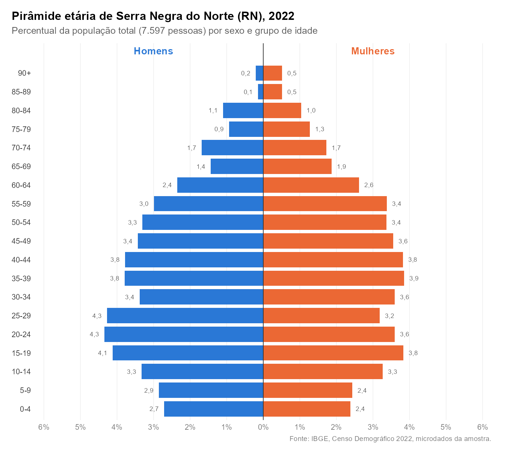

# Serra Negra do Norte (RN)

Resultados do Censo Demográfico 2022 (microdados da amostra). Gerado por `R/05_readmes.R`; veja a [página dos municípios](../README.md) e o [README principal](../../../../README.md).

População: **7.597** pessoas (1.602 registros na amostra).

## Estrutura etária

| Indicador | Serra Negra do Norte | RN |
|---|--:|--:|
| Razão de dependência jovem | 24,1 | 28,5 |
| Razão de dependência idosa | 17,6 | 15,1 |
| Razão de dependência total | 41,7 | 43,6 |
| Índice de envelhecimento | 73,3 | 52,9 |

Valores por 100 pessoas.

## Migração

Chegadas e saídas: mudanças de município nos últimos 10 anos.

| Indicador | Valor |
|---|--:|
| Nascidos no próprio município | 78,8% |
| Nascidos em outro município do Rio Grande do Norte | 8,9% |
| Nascidos em outra UF | 12,2% |
| Nascidos no exterior | 0,1% |
| Chegaram de outro município do Rio Grande do Norte | 437 |
| Chegaram de outra UF | 663 |
| Saíram para outro município da UF | 352 |
| Saíram para outra UF | 393 |
| Saldo migratório | +355 |
| Saldo por 1.000 habitantes | +46,7 |
| Chegaram do exterior | 4 |

Principais origens de quem chegou e destinos de quem saiu:

| Origem | Chegaram | Destino | Saíram |
|---|--:|---|--:|
| Caicó (RN) | 212 | Caicó (RN) | 135 |
| São Bento (PB) | 120 | São Bento (PB) | 118 |
| Paulista (PB) | 58 | Timbaúba dos Batistas (RN) | 104 |
| Patos (PB) | 55 | Patos (PB) | 69 |
| São José de Espinharas (PB) | 53 | Nísia Floresta (RN) | 42 |

## Mortalidade

Óbitos de agosto de 2021 a julho de 2022 informados no Censo.

| Indicador | Serra Negra do Norte | RN |
|---|--:|--:|
| Óbitos no período | 51 | 22.488 |
| Registros de óbito na amostra | 11 |  |
| Taxa bruta de mortalidade (por mil) | 6,8 | 6,8 |
| Taxa padronizada por idade (por mil) | 5,9 | 6,8 |

Com poucos óbitos na amostra, as taxas deste município variam muito por acaso; por isso não há tábua de vida. Sem correção do sub-registro de óbitos do Censo.
