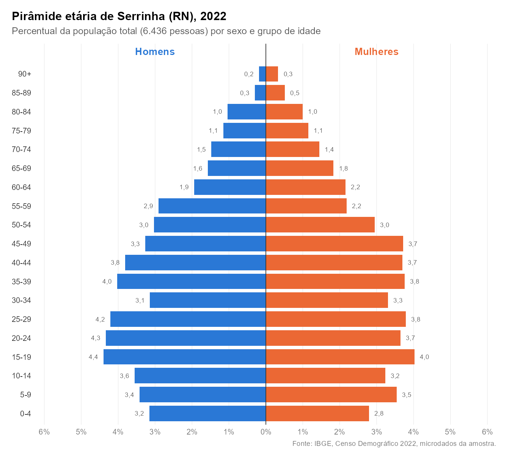

# Serrinha (RN)

Resultados do Censo Demográfico 2022 (microdados da amostra). Gerado por `R/05_readmes.R`; veja a [página dos municípios](../README.md) e o [README principal](../../../../README.md).

População: **6.436** pessoas (2.125 registros na amostra).

## Estrutura etária

| Indicador | Serrinha | RN |
|---|--:|--:|
| Razão de dependência jovem | 28,8 | 28,5 |
| Razão de dependência idosa | 17,6 | 15,1 |
| Razão de dependência total | 46,4 | 43,6 |
| Índice de envelhecimento | 60,9 | 52,9 |

Valores por 100 pessoas.

## Migração

Chegadas e saídas: mudanças de município nos últimos 10 anos.

| Indicador | Valor |
|---|--:|
| Nascidos no próprio município | 72,0% |
| Nascidos em outro município do Rio Grande do Norte | 24,6% |
| Nascidos em outra UF | 3,4% |
| Nascidos no exterior | 0,0% |
| Chegaram de outro município do Rio Grande do Norte | 736 |
| Chegaram de outra UF | 147 |
| Saíram para outro município da UF | 962 |
| Saíram para outra UF | 298 |
| Saldo migratório | -378 |
| Saldo por 1.000 habitantes | -58,7 |
| Chegaram do exterior | 0 |

Principais origens de quem chegou e destinos de quem saiu:

| Origem | Chegaram | Destino | Saíram |
|---|--:|---|--:|
| Santo Antônio (RN) | 190 | Natal (RN) | 177 |
| Natal (RN) | 140 | Santo Antônio (RN) | 132 |
| Lagoa de Pedras (RN) | 85 | Parnamirim (RN) | 116 |
| Parnamirim (RN) | 62 | Januário Cicco (RN) | 79 |
| Rio de Janeiro (RJ) | 52 | Ceará-Mirim (RN) | 73 |

## Mortalidade

Óbitos de agosto de 2021 a julho de 2022 informados no Censo.

| Indicador | Serrinha | RN |
|---|--:|--:|
| Óbitos no período | 30 | 22.488 |
| Registros de óbito na amostra | 11 |  |
| Taxa bruta de mortalidade (por mil) | 4,7 | 6,8 |
| Taxa padronizada por idade (por mil) | 4,6 | 6,8 |

Com poucos óbitos na amostra, as taxas deste município variam muito por acaso; por isso não há tábua de vida. Sem correção do sub-registro de óbitos do Censo.
