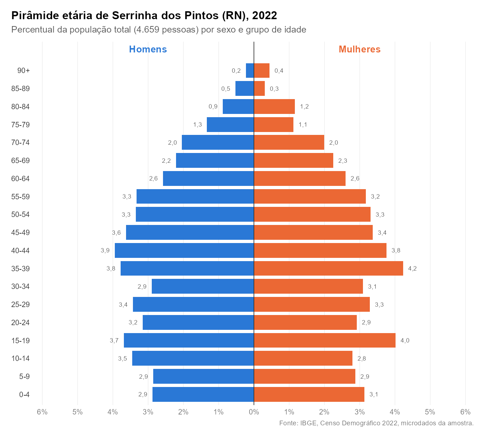

# Serrinha dos Pintos (RN)

Resultados do Censo Demográfico 2022 (microdados da amostra). Gerado por `R/05_readmes.R`; veja a [página dos municípios](../README.md) e o [README principal](../../../../README.md).

População: **4.659** pessoas (1.561 registros na amostra).

## Estrutura etária

| Indicador | Serrinha dos Pintos | RN |
|---|--:|--:|
| Razão de dependência jovem | 26,6 | 28,5 |
| Razão de dependência idosa | 21,5 | 15,1 |
| Razão de dependência total | 48,1 | 43,6 |
| Índice de envelhecimento | 80,5 | 52,9 |

Valores por 100 pessoas.

## Migração

Chegadas e saídas: mudanças de município nos últimos 10 anos.

| Indicador | Valor |
|---|--:|
| Nascidos no próprio município | 81,7% |
| Nascidos em outro município do Rio Grande do Norte | 13,2% |
| Nascidos em outra UF | 5,1% |
| Nascidos no exterior | 0,0% |
| Chegaram de outro município do Rio Grande do Norte | 379 |
| Chegaram de outra UF | 304 |
| Saíram para outro município da UF | 262 |
| Saíram para outra UF | 42 |
| Saldo migratório | +378 |
| Saldo por 1.000 habitantes | +81,1 |
| Chegaram do exterior | 0 |

Principais origens de quem chegou e destinos de quem saiu:

| Origem | Chegaram | Destino | Saíram |
|---|--:|---|--:|
| São Paulo (SP) | 108 | Natal (RN) | 71 |
| Natal (RN) | 96 | Martins (RN) | 62 |
| Martins (RN) | 80 | Mossoró (RN) | 42 |
| Antônio Martins (RN) | 46 | Brejo da Madre de Deus (PE) | 32 |
| Brasília (DF) | 38 | Portalegre (RN) | 22 |

## Mortalidade

Óbitos de agosto de 2021 a julho de 2022 informados no Censo.

| Indicador | Serrinha dos Pintos | RN |
|---|--:|--:|
| Óbitos no período | 32 | 22.488 |
| Registros de óbito na amostra | 11 |  |
| Taxa bruta de mortalidade (por mil) | 6,9 | 6,8 |
| Taxa padronizada por idade (por mil) | 5,6 | 6,8 |

Com poucos óbitos na amostra, as taxas deste município variam muito por acaso; por isso não há tábua de vida. Sem correção do sub-registro de óbitos do Censo.
