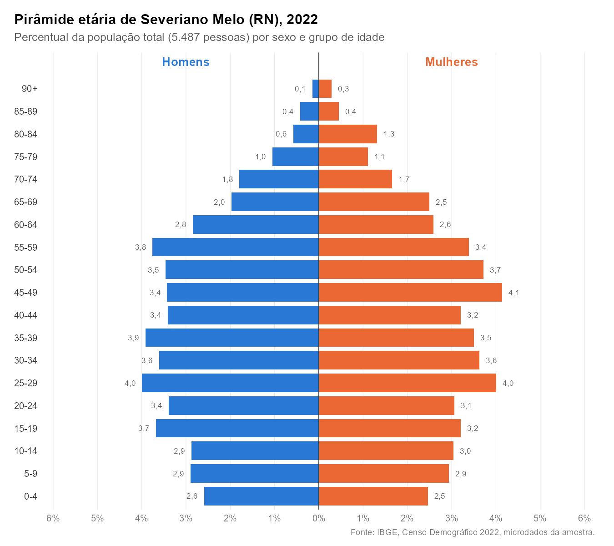

# Severiano Melo (RN)

Resultados do Censo Demográfico 2022 (microdados da amostra). Gerado por `R/05_readmes.R`; veja a [página dos municípios](../README.md) e o [README principal](../../../../README.md).

População: **5.487** pessoas (2.727 registros na amostra).

## Estrutura etária

| Indicador | Severiano Melo | RN |
|---|--:|--:|
| Razão de dependência jovem | 24,0 | 28,5 |
| Razão de dependência idosa | 19,0 | 15,1 |
| Razão de dependência total | 43,0 | 43,6 |
| Índice de envelhecimento | 79,0 | 52,9 |

Valores por 100 pessoas.

## Migração

Chegadas e saídas: mudanças de município nos últimos 10 anos.

| Indicador | Valor |
|---|--:|
| Nascidos no próprio município | 82,1% |
| Nascidos em outro município do Rio Grande do Norte | 13,0% |
| Nascidos em outra UF | 4,9% |
| Nascidos no exterior | 0,0% |
| Chegaram de outro município do Rio Grande do Norte | 412 |
| Chegaram de outra UF | 161 |
| Saíram para outro município da UF | 710 |
| Saíram para outra UF | 120 |
| Saldo migratório | -257 |
| Saldo por 1.000 habitantes | -46,8 |
| Chegaram do exterior | 0 |

Principais origens de quem chegou e destinos de quem saiu:

| Origem | Chegaram | Destino | Saíram |
|---|--:|---|--:|
| Mossoró (RN) | 129 | Apodi (RN) | 207 |
| Apodi (RN) | 59 | Mossoró (RN) | 169 |
| Itaú (RN) | 51 | Itaú (RN) | 59 |
| Alto Santo (CE) | 51 | Pau dos Ferros (RN) | 53 |
| Natal (RN) | 44 | Natal (RN) | 23 |

## Mortalidade

Óbitos de agosto de 2021 a julho de 2022 informados no Censo.

| Indicador | Severiano Melo | RN |
|---|--:|--:|
| Óbitos no período | 30 | 22.488 |
| Registros de óbito na amostra | 15 |  |
| Taxa bruta de mortalidade (por mil) | 5,4 | 6,8 |
| Taxa padronizada por idade (por mil) | 4,9 | 6,8 |

Com poucos óbitos na amostra, as taxas deste município variam muito por acaso; por isso não há tábua de vida. Sem correção do sub-registro de óbitos do Censo.
