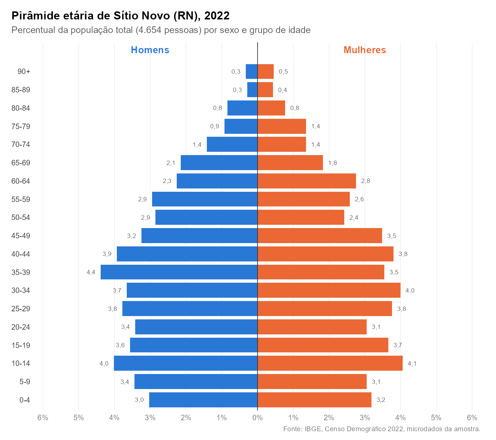

# Sítio Novo (RN)

Resultados do Censo Demográfico 2022 (microdados da amostra). Gerado por `R/05_readmes.R`; veja a [página dos municípios](../README.md) e o [README principal](../../../../README.md).

População: **4.654** pessoas (1.566 registros na amostra).

## Estrutura etária

| Indicador | Sítio Novo | RN |
|---|--:|--:|
| Razão de dependência jovem | 31,0 | 28,5 |
| Razão de dependência idosa | 18,1 | 15,1 |
| Razão de dependência total | 49,1 | 43,6 |
| Índice de envelhecimento | 58,4 | 52,9 |

Valores por 100 pessoas.

## Migração

Chegadas e saídas: mudanças de município nos últimos 10 anos.

| Indicador | Valor |
|---|--:|
| Nascidos no próprio município | 83,4% |
| Nascidos em outro município do Rio Grande do Norte | 14,0% |
| Nascidos em outra UF | 2,6% |
| Nascidos no exterior | 0,0% |
| Chegaram de outro município do Rio Grande do Norte | 440 |
| Chegaram de outra UF | 123 |
| Saíram para outro município da UF | 617 |
| Saíram para outra UF | 131 |
| Saldo migratório | -186 |
| Saldo por 1.000 habitantes | -39,9 |
| Chegaram do exterior | 0 |

Principais origens de quem chegou e destinos de quem saiu:

| Origem | Chegaram | Destino | Saíram |
|---|--:|---|--:|
| Natal (RN) | 107 | Santa Cruz (RN) | 168 |
| Santa Cruz (RN) | 97 | Natal (RN) | 151 |
| São Paulo (SP) | 59 | Tangará (RN) | 78 |
| Lagoa de Velhos (RN) | 34 | São Paulo (SP) | 45 |
| São Tomé (RN) | 24 | Macaíba (RN) | 41 |

## Mortalidade

Óbitos de agosto de 2021 a julho de 2022 informados no Censo.

| Indicador | Sítio Novo | RN |
|---|--:|--:|
| Óbitos no período | 48 | 22.488 |
| Registros de óbito na amostra | 15 |  |
| Taxa bruta de mortalidade (por mil) | 10,4 | 6,8 |
| Taxa padronizada por idade (por mil) | 9,0 | 6,8 |

Com poucos óbitos na amostra, as taxas deste município variam muito por acaso; por isso não há tábua de vida. Sem correção do sub-registro de óbitos do Censo.
