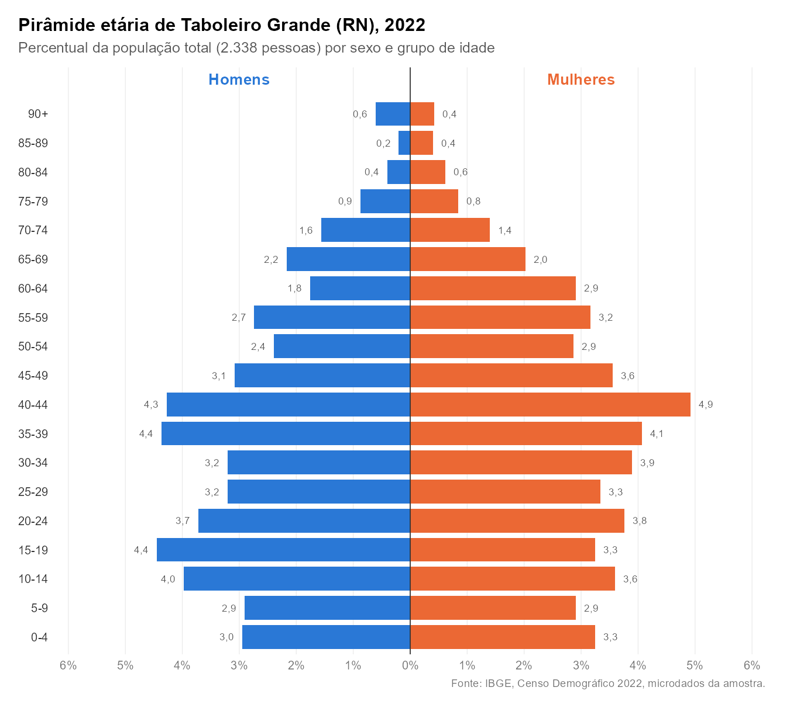

# Taboleiro Grande (RN)

Resultados do Censo Demográfico 2022 (microdados da amostra). Gerado por `R/05_readmes.R`; veja a [página dos municípios](../README.md) e o [README principal](../../../../README.md).

População: **2.338** pessoas (776 registros na amostra).

## Estrutura etária

| Indicador | Taboleiro Grande | RN |
|---|--:|--:|
| Razão de dependência jovem | 28,4 | 28,5 |
| Razão de dependência idosa | 16,7 | 15,1 |
| Razão de dependência total | 45,1 | 43,6 |
| Índice de envelhecimento | 58,7 | 52,9 |

Valores por 100 pessoas.

## Migração

Chegadas e saídas: mudanças de município nos últimos 10 anos.

| Indicador | Valor |
|---|--:|
| Nascidos no próprio município | 58,6% |
| Nascidos em outro município do Rio Grande do Norte | 29,8% |
| Nascidos em outra UF | 11,6% |
| Nascidos no exterior | 0,0% |
| Chegaram de outro município do Rio Grande do Norte | 390 |
| Chegaram de outra UF | 123 |
| Saíram para outro município da UF | 352 |
| Saíram para outra UF | 6 |
| Saldo migratório | +154 |
| Saldo por 1.000 habitantes | +65,9 |
| Chegaram do exterior | 4 |

Principais origens de quem chegou e destinos de quem saiu:

| Origem | Chegaram | Destino | Saíram |
|---|--:|---|--:|
| Pau dos Ferros (RN) | 83 | São Francisco do Oeste (RN) | 49 |
| Itaú (RN) | 75 | Pau dos Ferros (RN) | 40 |
| Mossoró (RN) | 72 | Natal (RN) | 38 |
| Portalegre (RN) | 24 | Mossoró (RN) | 27 |
| Francisco Dantas (RN) | 21 | Portalegre (RN) | 27 |

## Mortalidade

Óbitos de agosto de 2021 a julho de 2022 informados no Censo.

| Indicador | Taboleiro Grande | RN |
|---|--:|--:|
| Óbitos no período | 19 | 22.488 |
| Registros de óbito na amostra | 5 |  |
| Taxa bruta de mortalidade (por mil) | 8,3 | 6,8 |
| Taxa padronizada por idade (por mil) | 9,0 | 6,8 |

Com poucos óbitos na amostra, as taxas deste município variam muito por acaso; por isso não há tábua de vida. Sem correção do sub-registro de óbitos do Censo.
