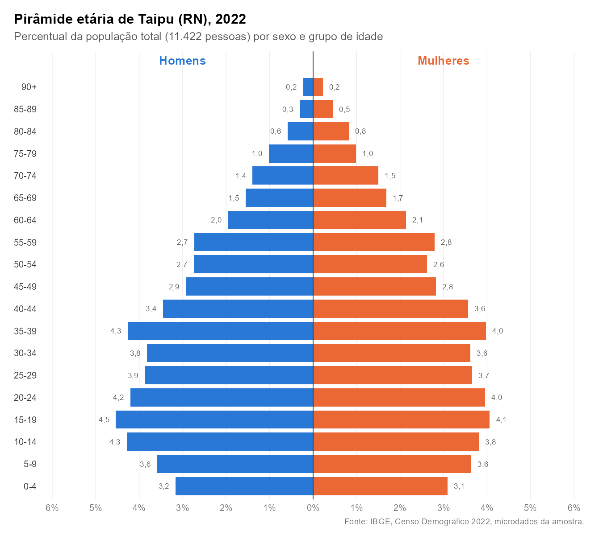

# Taipu (RN)

Resultados do Censo Demográfico 2022 (microdados da amostra). Gerado por `R/05_readmes.R`; veja a [página dos municípios](../README.md) e o [README principal](../../../../README.md).

População: **11.422** pessoas (2.254 registros na amostra).

## Estrutura etária

| Indicador | Taipu | RN |
|---|--:|--:|
| Razão de dependência jovem | 31,9 | 28,5 |
| Razão de dependência idosa | 15,9 | 15,1 |
| Razão de dependência total | 47,7 | 43,6 |
| Índice de envelhecimento | 49,8 | 52,9 |

Valores por 100 pessoas.

## Migração

Chegadas e saídas: mudanças de município nos últimos 10 anos.

| Indicador | Valor |
|---|--:|
| Nascidos no próprio município | 85,7% |
| Nascidos em outro município do Rio Grande do Norte | 13,0% |
| Nascidos em outra UF | 1,3% |
| Nascidos no exterior | 0,0% |
| Chegaram de outro município do Rio Grande do Norte | 639 |
| Chegaram de outra UF | 34 |
| Saíram para outro município da UF | 1.746 |
| Saíram para outra UF | 265 |
| Saldo migratório | -1.337 |
| Saldo por 1.000 habitantes | -117,0 |
| Chegaram do exterior | 0 |

Principais origens de quem chegou e destinos de quem saiu:

| Origem | Chegaram | Destino | Saíram |
|---|--:|---|--:|
| Natal (RN) | 265 | Ceará-Mirim (RN) | 393 |
| Poço Branco (RN) | 68 | Natal (RN) | 389 |
| Ceará-Mirim (RN) | 64 | São Gonçalo do Amarante (RN) | 231 |
| João Câmara (RN) | 35 | Extremoz (RN) | 149 |
| Parnamirim (RN) | 33 | Poço Branco (RN) | 133 |

## Mortalidade

Óbitos de agosto de 2021 a julho de 2022 informados no Censo.

| Indicador | Taipu | RN |
|---|--:|--:|
| Óbitos no período | 59 | 22.488 |
| Registros de óbito na amostra | 11 |  |
| Taxa bruta de mortalidade (por mil) | 5,2 | 6,8 |
| Taxa padronizada por idade (por mil) | 5,1 | 6,8 |

Com poucos óbitos na amostra, as taxas deste município variam muito por acaso; por isso não há tábua de vida. Sem correção do sub-registro de óbitos do Censo.
