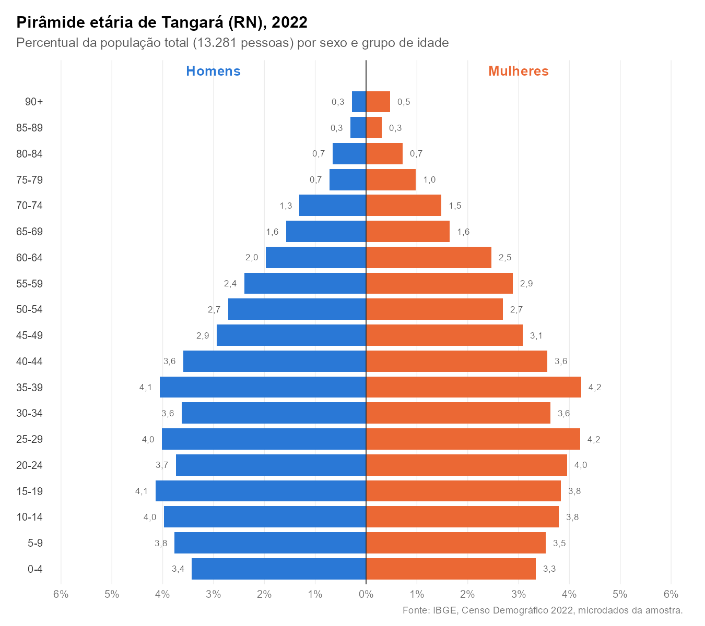

# Tangará (RN)

Resultados do Censo Demográfico 2022 (microdados da amostra). Gerado por `R/05_readmes.R`; veja a [página dos municípios](../README.md) e o [README principal](../../../../README.md).

População: **13.281** pessoas (2.595 registros na amostra).

## Estrutura etária

| Indicador | Tangará | RN |
|---|--:|--:|
| Razão de dependência jovem | 32,2 | 28,5 |
| Razão de dependência idosa | 15,4 | 15,1 |
| Razão de dependência total | 47,6 | 43,6 |
| Índice de envelhecimento | 47,8 | 52,9 |

Valores por 100 pessoas.

## Migração

Chegadas e saídas: mudanças de município nos últimos 10 anos.

| Indicador | Valor |
|---|--:|
| Nascidos no próprio município | 69,5% |
| Nascidos em outro município do Rio Grande do Norte | 26,5% |
| Nascidos em outra UF | 4,0% |
| Nascidos no exterior | 0,0% |
| Chegaram de outro município do Rio Grande do Norte | 1.208 |
| Chegaram de outra UF | 232 |
| Saíram para outro município da UF | 1.538 |
| Saíram para outra UF | 365 |
| Saldo migratório | -462 |
| Saldo por 1.000 habitantes | -34,8 |
| Chegaram do exterior | 11 |

Principais origens de quem chegou e destinos de quem saiu:

| Origem | Chegaram | Destino | Saíram |
|---|--:|---|--:|
| Natal (RN) | 308 | Natal (RN) | 435 |
| Santa Cruz (RN) | 155 | Parnamirim (RN) | 341 |
| Serra Caiada (RN) | 99 | Serra Caiada (RN) | 139 |
| Sítio Novo (RN) | 78 | Santa Cruz (RN) | 118 |
| Parnamirim (RN) | 62 | Bom Jesus (RN) | 70 |

## Mortalidade

Óbitos de agosto de 2021 a julho de 2022 informados no Censo.

| Indicador | Tangará | RN |
|---|--:|--:|
| Óbitos no período | 89 | 22.488 |
| Registros de óbito na amostra | 18 |  |
| Taxa bruta de mortalidade (por mil) | 6,7 | 6,8 |
| Taxa padronizada por idade (por mil) | 6,5 | 6,8 |

Com poucos óbitos na amostra, as taxas deste município variam muito por acaso; por isso não há tábua de vida. Sem correção do sub-registro de óbitos do Censo.
