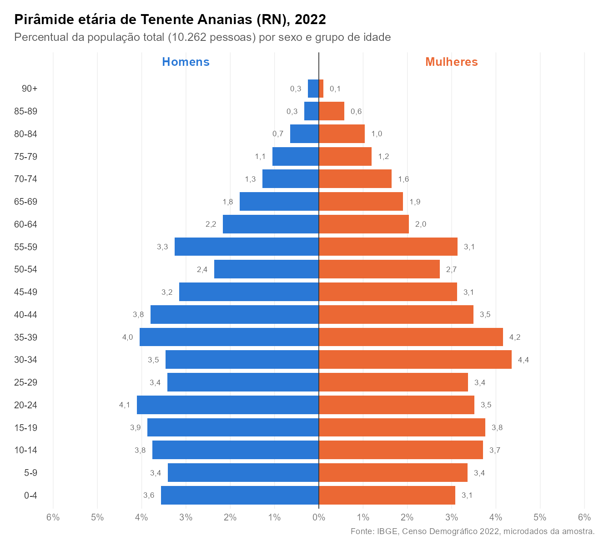

# Tenente Ananias (RN)

Resultados do Censo Demográfico 2022 (microdados da amostra). Gerado por `R/05_readmes.R`; veja a [página dos municípios](../README.md) e o [README principal](../../../../README.md).

População: **10.262** pessoas (2.047 registros na amostra).

## Estrutura etária

| Indicador | Tenente Ananias | RN |
|---|--:|--:|
| Razão de dependência jovem | 31,0 | 28,5 |
| Razão de dependência idosa | 17,5 | 15,1 |
| Razão de dependência total | 48,6 | 43,6 |
| Índice de envelhecimento | 56,5 | 52,9 |

Valores por 100 pessoas.

## Migração

Chegadas e saídas: mudanças de município nos últimos 10 anos.

| Indicador | Valor |
|---|--:|
| Nascidos no próprio município | 76,2% |
| Nascidos em outro município do Rio Grande do Norte | 10,9% |
| Nascidos em outra UF | 13,0% |
| Nascidos no exterior | 0,0% |
| Chegaram de outro município do Rio Grande do Norte | 586 |
| Chegaram de outra UF | 948 |
| Saíram para outro município da UF | 458 |
| Saíram para outra UF | 943 |
| Saldo migratório | +134 |
| Saldo por 1.000 habitantes | +13,0 |
| Chegaram do exterior | 0 |

Principais origens de quem chegou e destinos de quem saiu:

| Origem | Chegaram | Destino | Saíram |
|---|--:|---|--:|
| Sousa (PB) | 129 | Sousa (PB) | 100 |
| Natal (RN) | 123 | São Paulo (SP) | 100 |
| Lastro (PB) | 91 | Cajazeiras (PB) | 89 |
| Alexandria (RN) | 88 | Alexandria (RN) | 64 |
| Paraná (RN) | 73 | Paraná (RN) | 63 |

## Mortalidade

Óbitos de agosto de 2021 a julho de 2022 informados no Censo.

| Indicador | Tenente Ananias | RN |
|---|--:|--:|
| Óbitos no período | 55 | 22.488 |
| Registros de óbito na amostra | 13 |  |
| Taxa bruta de mortalidade (por mil) | 5,4 | 6,8 |
| Taxa padronizada por idade (por mil) | 5,2 | 6,8 |

Com poucos óbitos na amostra, as taxas deste município variam muito por acaso; por isso não há tábua de vida. Sem correção do sub-registro de óbitos do Censo.
