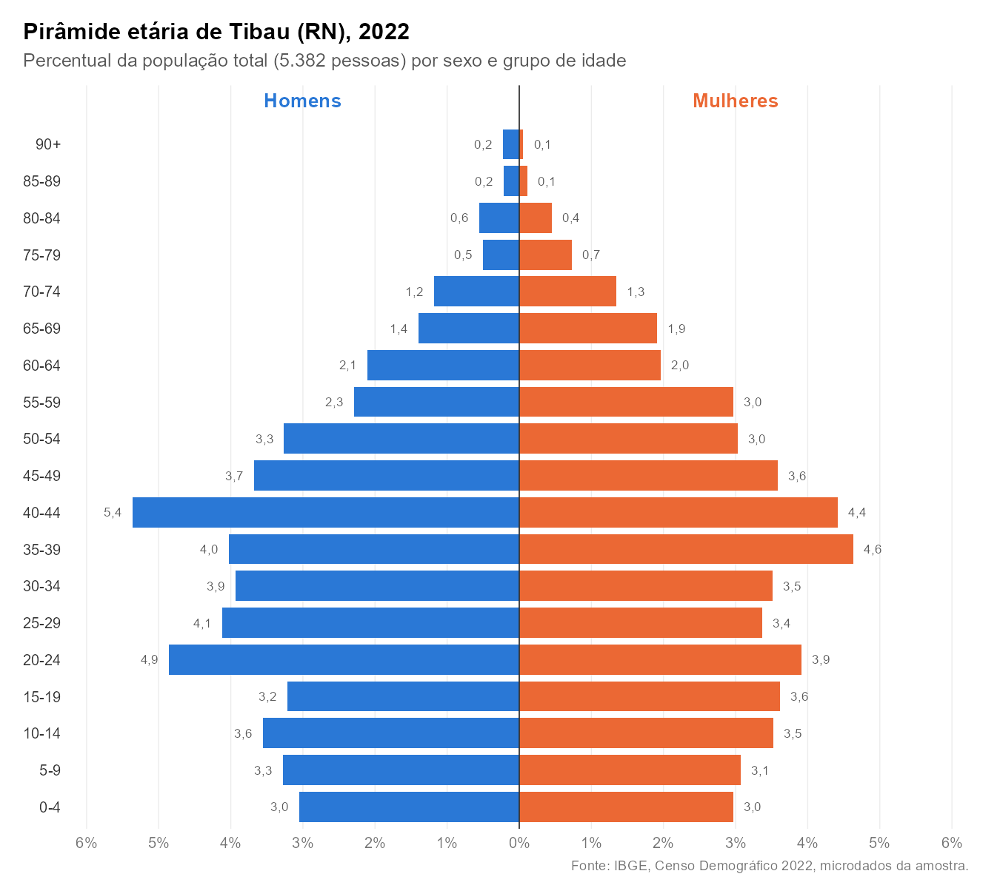

# Tibau (RN)

Resultados do Censo Demográfico 2022 (microdados da amostra). Gerado por `R/05_readmes.R`; veja a [página dos municípios](../README.md) e o [README principal](../../../../README.md).

População: **5.382** pessoas (1.803 registros na amostra).

## Estrutura etária

| Indicador | Tibau | RN |
|---|--:|--:|
| Razão de dependência jovem | 27,1 | 28,5 |
| Razão de dependência idosa | 12,1 | 15,1 |
| Razão de dependência total | 39,1 | 43,6 |
| Índice de envelhecimento | 44,7 | 52,9 |

Valores por 100 pessoas.

## Migração

Chegadas e saídas: mudanças de município nos últimos 10 anos.

| Indicador | Valor |
|---|--:|
| Nascidos no próprio município | 49,6% |
| Nascidos em outro município do Rio Grande do Norte | 42,6% |
| Nascidos em outra UF | 7,8% |
| Nascidos no exterior | 0,0% |
| Chegaram de outro município do Rio Grande do Norte | 797 |
| Chegaram de outra UF | 225 |
| Saíram para outro município da UF | 599 |
| Saíram para outra UF | 420 |
| Saldo migratório | +3 |
| Saldo por 1.000 habitantes | +0,6 |
| Chegaram do exterior | 0 |

Principais origens de quem chegou e destinos de quem saiu:

| Origem | Chegaram | Destino | Saíram |
|---|--:|---|--:|
| Mossoró (RN) | 563 | Mossoró (RN) | 334 |
| Fortaleza (CE) | 44 | Icapuí (CE) | 332 |
| Aracati (CE) | 40 | Grossos (RN) | 48 |
| Natal (RN) | 32 | Governador Dix-Sept Rosado (RN) | 43 |
| Grossos (RN) | 30 | Parnamirim (RN) | 34 |

## Mortalidade

Óbitos de agosto de 2021 a julho de 2022 informados no Censo.

| Indicador | Tibau | RN |
|---|--:|--:|
| Óbitos no período | 24 | 22.488 |
| Registros de óbito na amostra | 8 |  |
| Taxa bruta de mortalidade (por mil) | 4,5 | 6,8 |
| Taxa padronizada por idade (por mil) | 5,1 | 6,8 |

Com poucos óbitos na amostra, as taxas deste município variam muito por acaso; por isso não há tábua de vida. Sem correção do sub-registro de óbitos do Censo.
