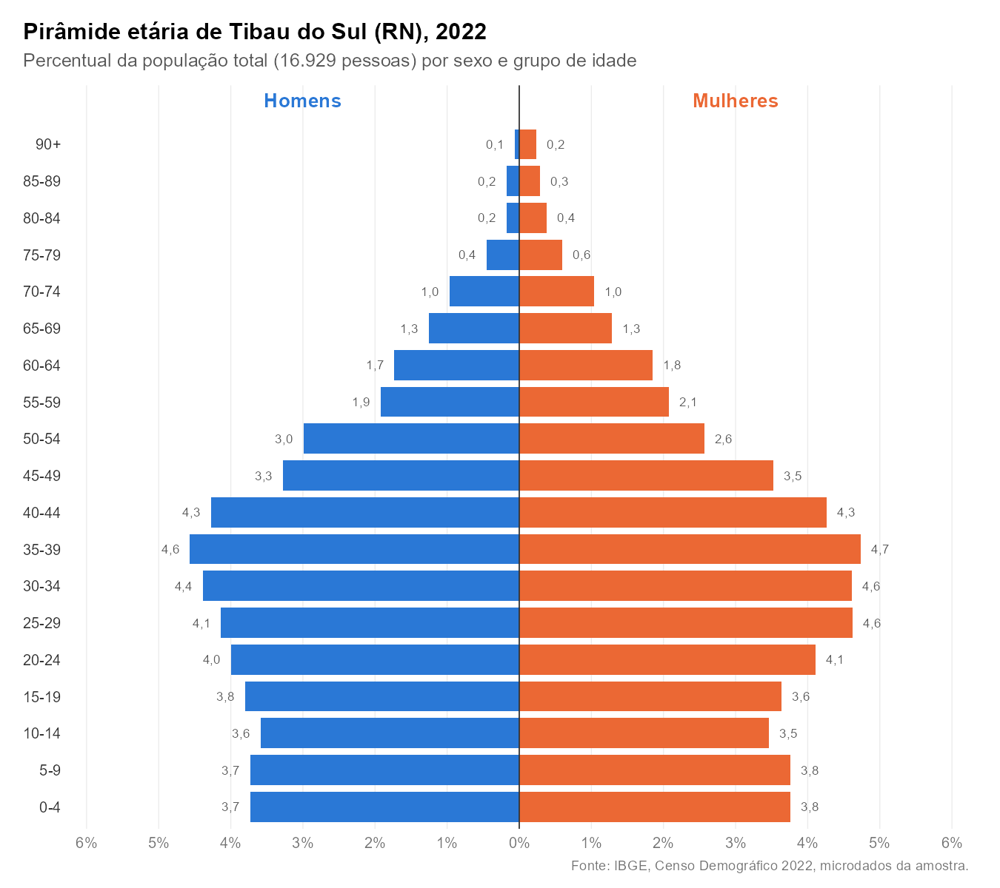

# Tibau do Sul (RN)

Resultados do Censo Demográfico 2022 (microdados da amostra). Gerado por `R/05_readmes.R`; veja a [página dos municípios](../README.md) e o [README principal](../../../../README.md).

População: **16.929** pessoas (3.182 registros na amostra).

## Estrutura etária

| Indicador | Tibau do Sul | RN |
|---|--:|--:|
| Razão de dependência jovem | 31,0 | 28,5 |
| Razão de dependência idosa | 9,7 | 15,1 |
| Razão de dependência total | 40,7 | 43,6 |
| Índice de envelhecimento | 31,3 | 52,9 |

Valores por 100 pessoas.

## Migração

Chegadas e saídas: mudanças de município nos últimos 10 anos.

| Indicador | Valor |
|---|--:|
| Nascidos no próprio município | 59,3% |
| Nascidos em outro município do Rio Grande do Norte | 22,3% |
| Nascidos em outra UF | 13,5% |
| Nascidos no exterior | 4,8% |
| Chegaram de outro município do Rio Grande do Norte | 2.212 |
| Chegaram de outra UF | 1.529 |
| Saíram para outro município da UF | 711 |
| Saíram para outra UF | 444 |
| Saldo migratório | +2.585 |
| Saldo por 1.000 habitantes | +152,7 |
| Chegaram do exterior | 561 |

Principais origens de quem chegou e destinos de quem saiu:

| Origem | Chegaram | Destino | Saíram |
|---|--:|---|--:|
| Natal (RN) | 808 | Goianinha (RN) | 151 |
| Goianinha (RN) | 231 | Natal (RN) | 96 |
| João Pessoa (PB) | 172 | Canguaretama (RN) | 87 |
| São Paulo (SP) | 140 | Belo Horizonte (MG) | 87 |
| Rio de Janeiro (RJ) | 137 | Baía Formosa (RN) | 63 |

## Mortalidade

Óbitos de agosto de 2021 a julho de 2022 informados no Censo.

| Indicador | Tibau do Sul | RN |
|---|--:|--:|
| Óbitos no período | 81 | 22.488 |
| Registros de óbito na amostra | 16 |  |
| Taxa bruta de mortalidade (por mil) | 4,8 | 6,8 |
| Taxa padronizada por idade (por mil) | 7,1 | 6,8 |

Com poucos óbitos na amostra, as taxas deste município variam muito por acaso; por isso não há tábua de vida. Sem correção do sub-registro de óbitos do Censo.
