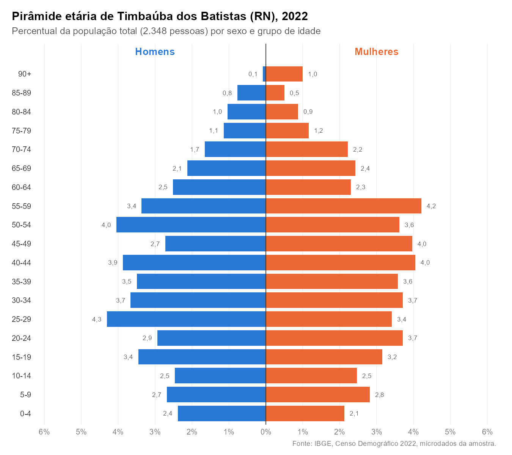

# Timbaúba dos Batistas (RN)

Resultados do Censo Demográfico 2022 (microdados da amostra). Gerado por `R/05_readmes.R`; veja a [página dos municípios](../README.md) e o [README principal](../../../../README.md).

População: **2.348** pessoas (1.212 registros na amostra).

## Estrutura etária

| Indicador | Timbaúba dos Batistas | RN |
|---|--:|--:|
| Razão de dependência jovem | 21,3 | 28,5 |
| Razão de dependência idosa | 21,4 | 15,1 |
| Razão de dependência total | 42,7 | 43,6 |
| Índice de envelhecimento | 100,3 | 52,9 |

Valores por 100 pessoas.

## Migração

Chegadas e saídas: mudanças de município nos últimos 10 anos.

| Indicador | Valor |
|---|--:|
| Nascidos no próprio município | 64,4% |
| Nascidos em outro município do Rio Grande do Norte | 29,0% |
| Nascidos em outra UF | 6,6% |
| Nascidos no exterior | 0,0% |
| Chegaram de outro município do Rio Grande do Norte | 375 |
| Chegaram de outra UF | 90 |
| Saíram para outro município da UF | 189 |
| Saíram para outra UF | 51 |
| Saldo migratório | +224 |
| Saldo por 1.000 habitantes | +95,4 |
| Chegaram do exterior | 0 |

Principais origens de quem chegou e destinos de quem saiu:

| Origem | Chegaram | Destino | Saíram |
|---|--:|---|--:|
| Caicó (RN) | 139 | Caicó (RN) | 110 |
| Serra Negra do Norte (RN) | 104 | Paulistana (PI) | 39 |
| Jardim de Piranhas (RN) | 35 | Jardim de Piranhas (RN) | 34 |
| Natal (RN) | 31 | São João do Sabugi (RN) | 13 |
| São Paulo (SP) | 16 | Mossoró (RN) | 11 |

## Mortalidade

Óbitos de agosto de 2021 a julho de 2022 informados no Censo.

| Indicador | Timbaúba dos Batistas | RN |
|---|--:|--:|
| Óbitos no período | 19 | 22.488 |
| Registros de óbito na amostra | 9 |  |
| Taxa bruta de mortalidade (por mil) | 8,1 | 6,8 |
| Taxa padronizada por idade (por mil) | 5,3 | 6,8 |

Com poucos óbitos na amostra, as taxas deste município variam muito por acaso; por isso não há tábua de vida. Sem correção do sub-registro de óbitos do Censo.
