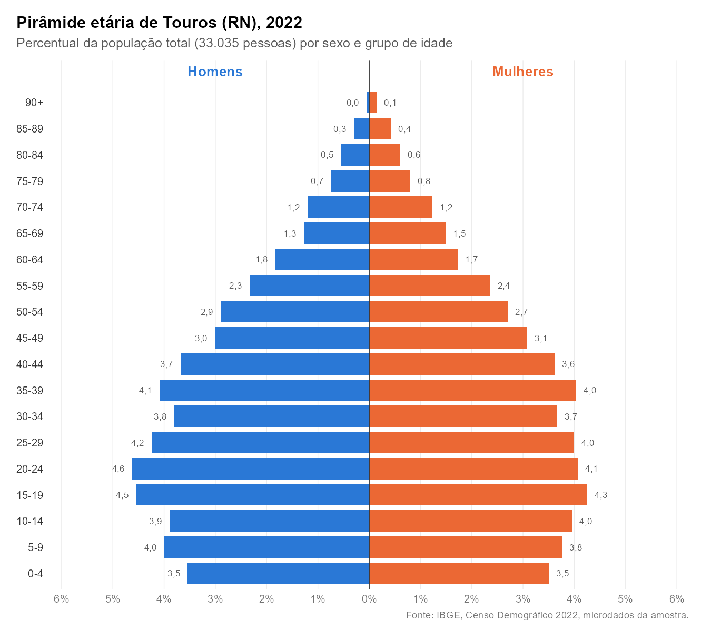

# Touros (RN)

Resultados do Censo Demográfico 2022 (microdados da amostra). Gerado por `R/05_readmes.R`; veja a [página dos municípios](../README.md) e o [README principal](../../../../README.md).

População: **33.035** pessoas (3.160 registros na amostra).

## Estrutura etária

| Indicador | Touros | RN |
|---|--:|--:|
| Razão de dependência jovem | 33,0 | 28,5 |
| Razão de dependência idosa | 12,9 | 15,1 |
| Razão de dependência total | 45,9 | 43,6 |
| Índice de envelhecimento | 38,9 | 52,9 |

Valores por 100 pessoas.

## Migração

Chegadas e saídas: mudanças de município nos últimos 10 anos.

| Indicador | Valor |
|---|--:|
| Nascidos no próprio município | 74,9% |
| Nascidos em outro município do Rio Grande do Norte | 21,1% |
| Nascidos em outra UF | 3,9% |
| Nascidos no exterior | 0,0% |
| Chegaram de outro município do Rio Grande do Norte | 3.696 |
| Chegaram de outra UF | 727 |
| Saíram para outro município da UF | 3.408 |
| Saíram para outra UF | 586 |
| Saldo migratório | +429 |
| Saldo por 1.000 habitantes | +13,0 |
| Chegaram do exterior | 0 |

Principais origens de quem chegou e destinos de quem saiu:

| Origem | Chegaram | Destino | Saíram |
|---|--:|---|--:|
| Natal (RN) | 1.459 | Natal (RN) | 888 |
| João Câmara (RN) | 381 | São Miguel do Gostoso (RN) | 387 |
| Pureza (RN) | 316 | Ceará-Mirim (RN) | 324 |
| Ceará-Mirim (RN) | 228 | Extremoz (RN) | 282 |
| São Paulo (SP) | 188 | Rio do Fogo (RN) | 171 |

## Mortalidade

Óbitos de agosto de 2021 a julho de 2022 informados no Censo.

| Indicador | Touros | RN |
|---|--:|--:|
| Óbitos no período | 278 | 22.488 |
| Registros de óbito na amostra | 26 |  |
| Taxa bruta de mortalidade (por mil) | 8,4 | 6,8 |
| Taxa padronizada por idade (por mil) | 11,7 | 6,8 |

Com poucos óbitos na amostra, as taxas deste município variam muito por acaso; por isso não há tábua de vida. Sem correção do sub-registro de óbitos do Censo.
