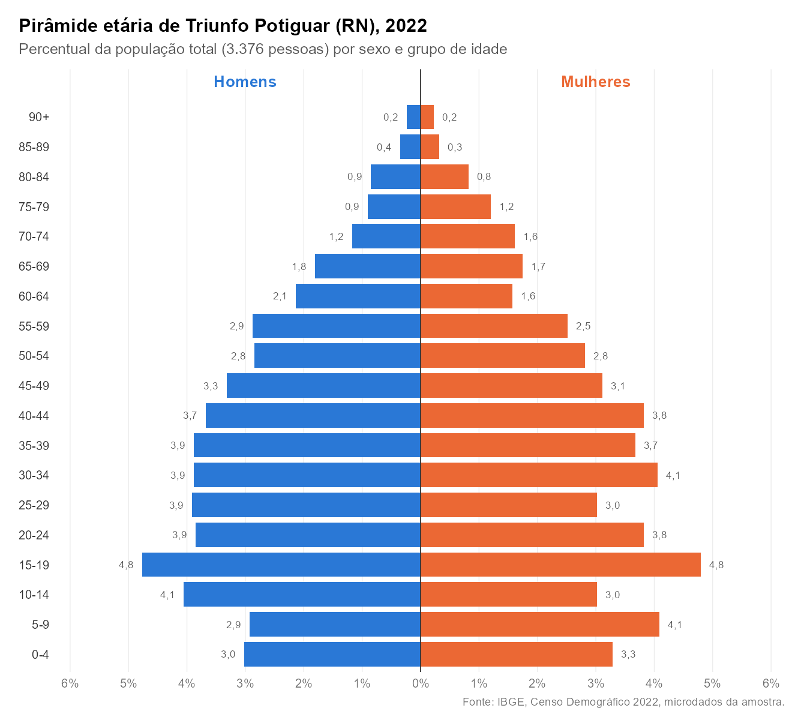

# Triunfo Potiguar (RN)

Resultados do Censo Demográfico 2022 (microdados da amostra). Gerado por `R/05_readmes.R`; veja a [página dos municípios](../README.md) e o [README principal](../../../../README.md).

População: **3.376** pessoas (1.125 registros na amostra).

## Estrutura etária

| Indicador | Triunfo Potiguar | RN |
|---|--:|--:|
| Razão de dependência jovem | 29,9 | 28,5 |
| Razão de dependência idosa | 16,5 | 15,1 |
| Razão de dependência total | 46,3 | 43,6 |
| Índice de envelhecimento | 55,2 | 52,9 |

Valores por 100 pessoas.

## Migração

Chegadas e saídas: mudanças de município nos últimos 10 anos.

| Indicador | Valor |
|---|--:|
| Nascidos no próprio município | 81,4% |
| Nascidos em outro município do Rio Grande do Norte | 16,5% |
| Nascidos em outra UF | 2,2% |
| Nascidos no exterior | 0,0% |
| Chegaram de outro município do Rio Grande do Norte | 400 |
| Chegaram de outra UF | 40 |
| Saíram para outro município da UF | 596 |
| Saíram para outra UF | 106 |
| Saldo migratório | -262 |
| Saldo por 1.000 habitantes | -77,6 |
| Chegaram do exterior | 0 |

Principais origens de quem chegou e destinos de quem saiu:

| Origem | Chegaram | Destino | Saíram |
|---|--:|---|--:|
| Natal (RN) | 92 | Mossoró (RN) | 189 |
| Jucurutu (RN) | 74 | Natal (RN) | 130 |
| Mossoró (RN) | 46 | Jucurutu (RN) | 88 |
| Açu (RN) | 45 | Campo Grande (RN) | 58 |
| Paraú (RN) | 39 | Feira de Santana (BA) | 40 |

## Mortalidade

Óbitos de agosto de 2021 a julho de 2022 informados no Censo.

| Indicador | Triunfo Potiguar | RN |
|---|--:|--:|
| Óbitos no período | 43 | 22.488 |
| Registros de óbito na amostra | 13 |  |
| Taxa bruta de mortalidade (por mil) | 12,9 | 6,8 |
| Taxa padronizada por idade (por mil) | 12,2 | 6,8 |

Com poucos óbitos na amostra, as taxas deste município variam muito por acaso; por isso não há tábua de vida. Sem correção do sub-registro de óbitos do Censo.
