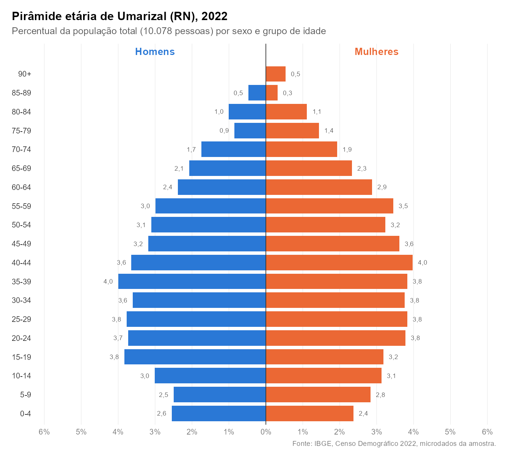

# Umarizal (RN)

Resultados do Censo Demográfico 2022 (microdados da amostra). Gerado por `R/05_readmes.R`; veja a [página dos municípios](../README.md) e o [README principal](../../../../README.md).

População: **10.078** pessoas (1.922 registros na amostra).

## Estrutura etária

| Indicador | Umarizal | RN |
|---|--:|--:|
| Razão de dependência jovem | 23,5 | 28,5 |
| Razão de dependência idosa | 19,8 | 15,1 |
| Razão de dependência total | 43,3 | 43,6 |
| Índice de envelhecimento | 84,3 | 52,9 |

Valores por 100 pessoas.

## Migração

Chegadas e saídas: mudanças de município nos últimos 10 anos.

| Indicador | Valor |
|---|--:|
| Nascidos no próprio município | 73,8% |
| Nascidos em outro município do Rio Grande do Norte | 22,2% |
| Nascidos em outra UF | 4,0% |
| Nascidos no exterior | 0,0% |
| Chegaram de outro município do Rio Grande do Norte | 702 |
| Chegaram de outra UF | 290 |
| Saíram para outro município da UF | 1.024 |
| Saíram para outra UF | 484 |
| Saldo migratório | -517 |
| Saldo por 1.000 habitantes | -51,3 |
| Chegaram do exterior | 0 |

Principais origens de quem chegou e destinos de quem saiu:

| Origem | Chegaram | Destino | Saíram |
|---|--:|---|--:|
| Mossoró (RN) | 163 | Mossoró (RN) | 224 |
| Natal (RN) | 76 | Parnamirim (RN) | 173 |
| Martins (RN) | 74 | Jataí (GO) | 81 |
| Apodi (RN) | 54 | Martins (RN) | 72 |
| Itaú (RN) | 45 | Salvador (BA) | 71 |

## Mortalidade

Óbitos de agosto de 2021 a julho de 2022 informados no Censo.

| Indicador | Umarizal | RN |
|---|--:|--:|
| Óbitos no período | 83 | 22.488 |
| Registros de óbito na amostra | 15 |  |
| Taxa bruta de mortalidade (por mil) | 8,2 | 6,8 |
| Taxa padronizada por idade (por mil) | 7,0 | 6,8 |

Com poucos óbitos na amostra, as taxas deste município variam muito por acaso; por isso não há tábua de vida. Sem correção do sub-registro de óbitos do Censo.
