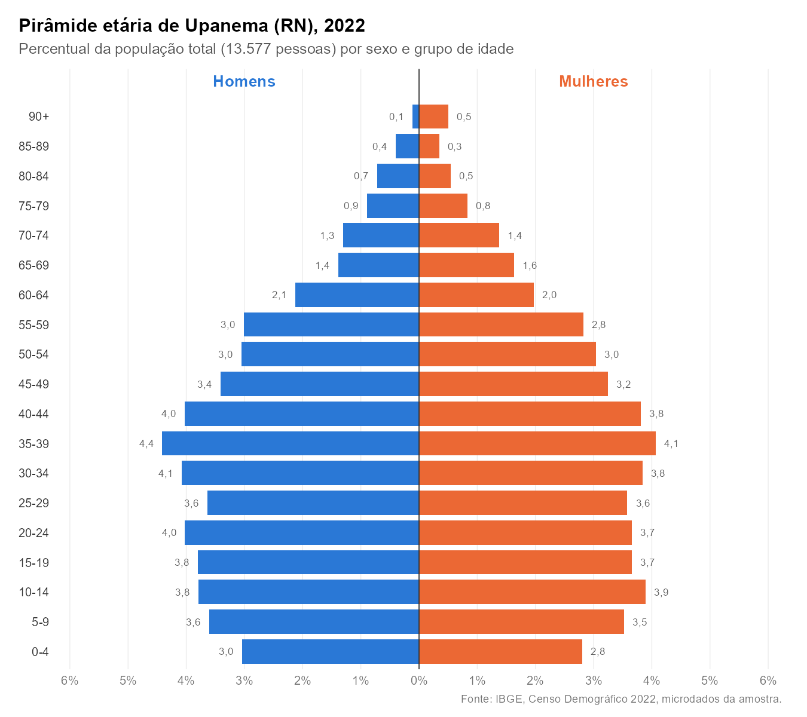

# Upanema (RN)

Resultados do Censo Demográfico 2022 (microdados da amostra). Gerado por `R/05_readmes.R`; veja a [página dos municípios](../README.md) e o [README principal](../../../../README.md).

População: **13.577** pessoas (2.682 registros na amostra).

## Estrutura etária

| Indicador | Upanema | RN |
|---|--:|--:|
| Razão de dependência jovem | 29,8 | 28,5 |
| Razão de dependência idosa | 14,5 | 15,1 |
| Razão de dependência total | 44,3 | 43,6 |
| Índice de envelhecimento | 48,6 | 52,9 |

Valores por 100 pessoas.

## Migração

Chegadas e saídas: mudanças de município nos últimos 10 anos.

| Indicador | Valor |
|---|--:|
| Nascidos no próprio município | 68,6% |
| Nascidos em outro município do Rio Grande do Norte | 28,2% |
| Nascidos em outra UF | 3,1% |
| Nascidos no exterior | 0,0% |
| Chegaram de outro município do Rio Grande do Norte | 1.461 |
| Chegaram de outra UF | 225 |
| Saíram para outro município da UF | 892 |
| Saíram para outra UF | 114 |
| Saldo migratório | +680 |
| Saldo por 1.000 habitantes | +50,1 |
| Chegaram do exterior | 11 |

Principais origens de quem chegou e destinos de quem saiu:

| Origem | Chegaram | Destino | Saíram |
|---|--:|---|--:|
| Mossoró (RN) | 549 | Mossoró (RN) | 340 |
| Campo Grande (RN) | 164 | Açu (RN) | 124 |
| Natal (RN) | 124 | Parnamirim (RN) | 100 |
| Caraúbas (RN) | 112 | Caraúbas (RN) | 98 |
| Açu (RN) | 94 | Campo Grande (RN) | 82 |

## Mortalidade

Óbitos de agosto de 2021 a julho de 2022 informados no Censo.

| Indicador | Upanema | RN |
|---|--:|--:|
| Óbitos no período | 57 | 22.488 |
| Registros de óbito na amostra | 13 |  |
| Taxa bruta de mortalidade (por mil) | 4,2 | 6,8 |
| Taxa padronizada por idade (por mil) | 4,4 | 6,8 |

Com poucos óbitos na amostra, as taxas deste município variam muito por acaso; por isso não há tábua de vida. Sem correção do sub-registro de óbitos do Censo.
