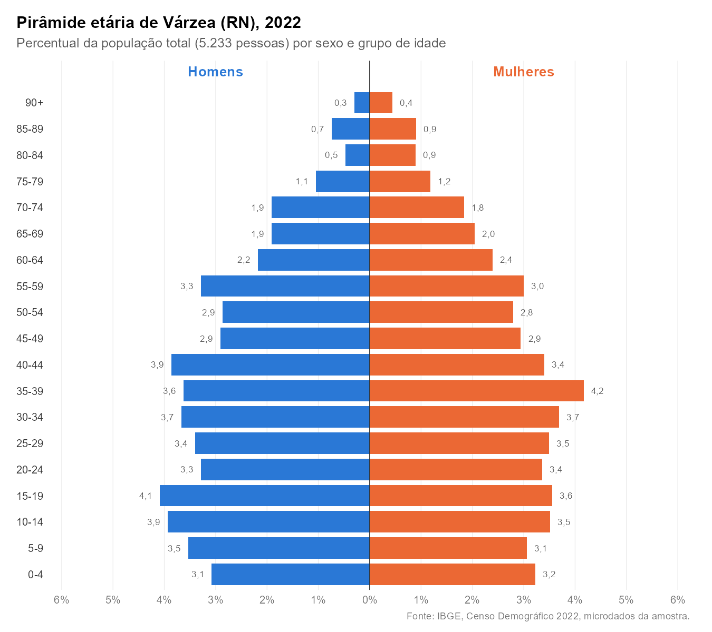

# Várzea (RN)

Resultados do Censo Demográfico 2022 (microdados da amostra). Gerado por `R/05_readmes.R`; veja a [página dos municípios](../README.md) e o [README principal](../../../../README.md).

População: **5.233** pessoas (1.802 registros na amostra).

## Estrutura etária

| Indicador | Várzea | RN |
|---|--:|--:|
| Razão de dependência jovem | 30,9 | 28,5 |
| Razão de dependência idosa | 20,7 | 15,1 |
| Razão de dependência total | 51,6 | 43,6 |
| Índice de envelhecimento | 67,2 | 52,9 |

Valores por 100 pessoas.

## Migração

Chegadas e saídas: mudanças de município nos últimos 10 anos.

| Indicador | Valor |
|---|--:|
| Nascidos no próprio município | 54,9% |
| Nascidos em outro município do Rio Grande do Norte | 38,6% |
| Nascidos em outra UF | 6,6% |
| Nascidos no exterior | 0,0% |
| Chegaram de outro município do Rio Grande do Norte | 635 |
| Chegaram de outra UF | 189 |
| Saíram para outro município da UF | 615 |
| Saíram para outra UF | 111 |
| Saldo migratório | +98 |
| Saldo por 1.000 habitantes | +18,7 |
| Chegaram do exterior | 0 |

Principais origens de quem chegou e destinos de quem saiu:

| Origem | Chegaram | Destino | Saíram |
|---|--:|---|--:|
| Natal (RN) | 106 | Natal (RN) | 120 |
| Parnamirim (RN) | 96 | Tibau do Sul (RN) | 82 |
| Espírito Santo (RN) | 87 | Espírito Santo (RN) | 81 |
| Rio de Janeiro (RJ) | 66 | Goianinha (RN) | 77 |
| Santo Antônio (RN) | 59 | Brasília (DF) | 75 |

## Mortalidade

Óbitos de agosto de 2021 a julho de 2022 informados no Censo.

| Indicador | Várzea | RN |
|---|--:|--:|
| Óbitos no período | 50 | 22.488 |
| Registros de óbito na amostra | 16 |  |
| Taxa bruta de mortalidade (por mil) | 9,6 | 6,8 |
| Taxa padronizada por idade (por mil) | 7,4 | 6,8 |

Com poucos óbitos na amostra, as taxas deste município variam muito por acaso; por isso não há tábua de vida. Sem correção do sub-registro de óbitos do Censo.
