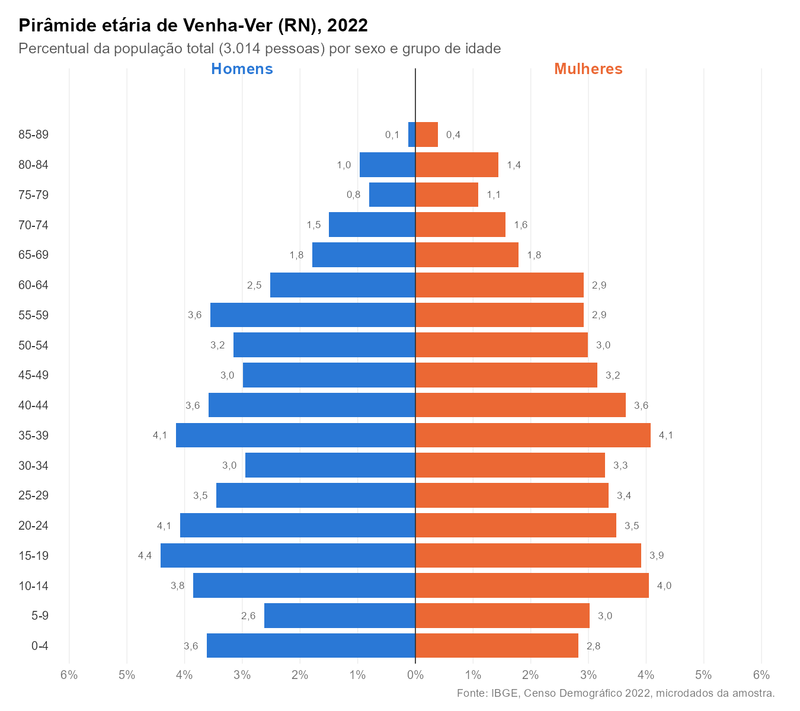

# Venha-Ver (RN)

Resultados do Censo Demográfico 2022 (microdados da amostra). Gerado por `R/05_readmes.R`; veja a [página dos municípios](../README.md) e o [README principal](../../../../README.md).

População: **3.014** pessoas (1.033 registros na amostra).

## Estrutura etária

| Indicador | Venha-Ver | RN |
|---|--:|--:|
| Razão de dependência jovem | 29,1 | 28,5 |
| Razão de dependência idosa | 16,7 | 15,1 |
| Razão de dependência total | 45,8 | 43,6 |
| Índice de envelhecimento | 57,3 | 52,9 |

Valores por 100 pessoas.

## Migração

Chegadas e saídas: mudanças de município nos últimos 10 anos.

| Indicador | Valor |
|---|--:|
| Nascidos no próprio município | 83,6% |
| Nascidos em outro município do Rio Grande do Norte | 6,5% |
| Nascidos em outra UF | 9,9% |
| Nascidos no exterior | 0,0% |
| Chegaram de outro município do Rio Grande do Norte | 108 |
| Chegaram de outra UF | 155 |
| Saíram para outro município da UF | 146 |
| Saíram para outra UF | 192 |
| Saldo migratório | -74 |
| Saldo por 1.000 habitantes | -24,7 |
| Chegaram do exterior | 0 |

Principais origens de quem chegou e destinos de quem saiu:

| Origem | Chegaram | Destino | Saíram |
|---|--:|---|--:|
| Poço Dantas (PB) | 51 | Santo André (SP) | 95 |
| Coronel João Pessoa (RN) | 44 | São Miguel (RN) | 58 |
| Icó (CE) | 32 | Icó (CE) | 32 |
| São Miguel (RN) | 28 | Rio de Janeiro (RJ) | 30 |
| Santo André (SP) | 23 | São Paulo (SP) | 24 |

## Mortalidade

Óbitos de agosto de 2021 a julho de 2022 informados no Censo.

| Indicador | Venha-Ver | RN |
|---|--:|--:|
| Óbitos no período | 16 | 22.488 |
| Registros de óbito na amostra | 6 |  |
| Taxa bruta de mortalidade (por mil) | 5,2 | 6,8 |
| Taxa padronizada por idade (por mil) | 4,8 | 6,8 |

Com poucos óbitos na amostra, as taxas deste município variam muito por acaso; por isso não há tábua de vida. Sem correção do sub-registro de óbitos do Censo.
